## Hi everyone! I'm Phil Chodrow {.split-40 background-image="../_img/midd/midd-banner-light.jpg" background-size="cover" background-position="center" background-repeat="no-repeat"} 


::: {.column}


<br>

::: {.textblock-1 .center}

Prof. of CS at [Middlebury College]{.alert-1}, a small liberal arts college in Vermont. I teach courses in discrete math, machine learning, data science, and network science. 

:::

<br>

::: {.textblock-2 .center}

*Junior folks: ask me about [**\#LiberalArtsLife**]{.alert-2} if you're curious.*

:::


<br>


::: {.textblock-3 .center}

I like aikido, tea, my cats, being outside, hypergraphs, and [math models of social systems]{.alert-3}. 

:::


:::

::: {.column}

{.absolute left=10% top=10% width=45%}
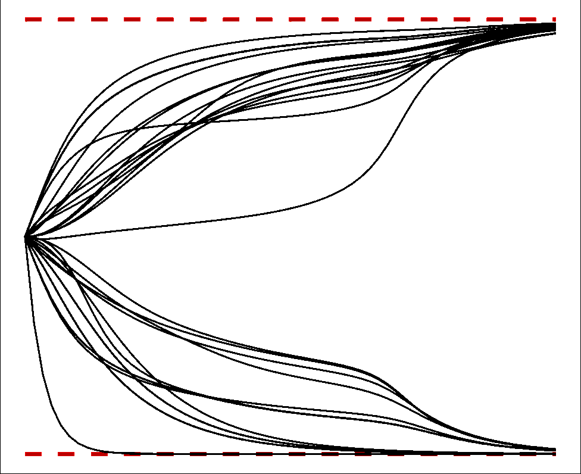{.absolute left=10% top=55% width=45%}
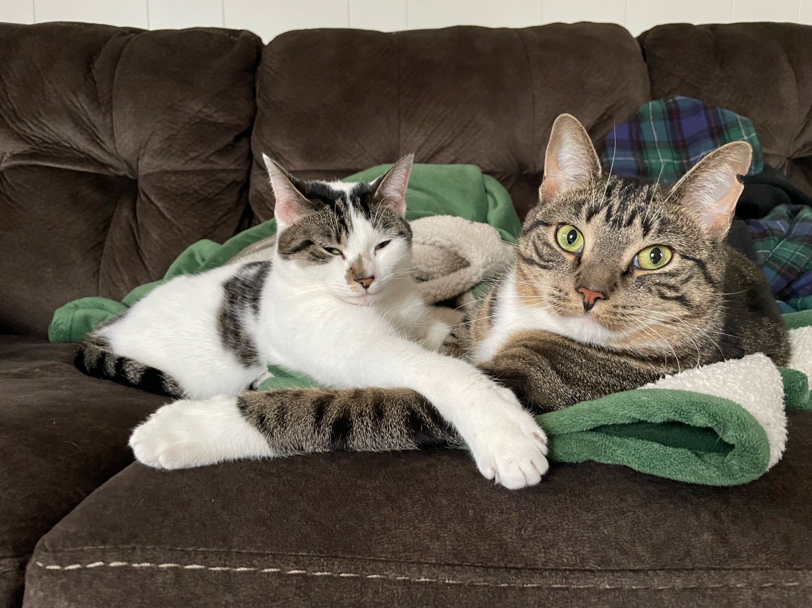{.absolute right=12% top=10% width=25.5%}
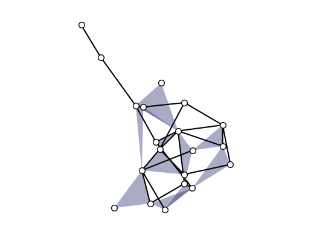{.absolute right=12% top=31% width=25.5%}
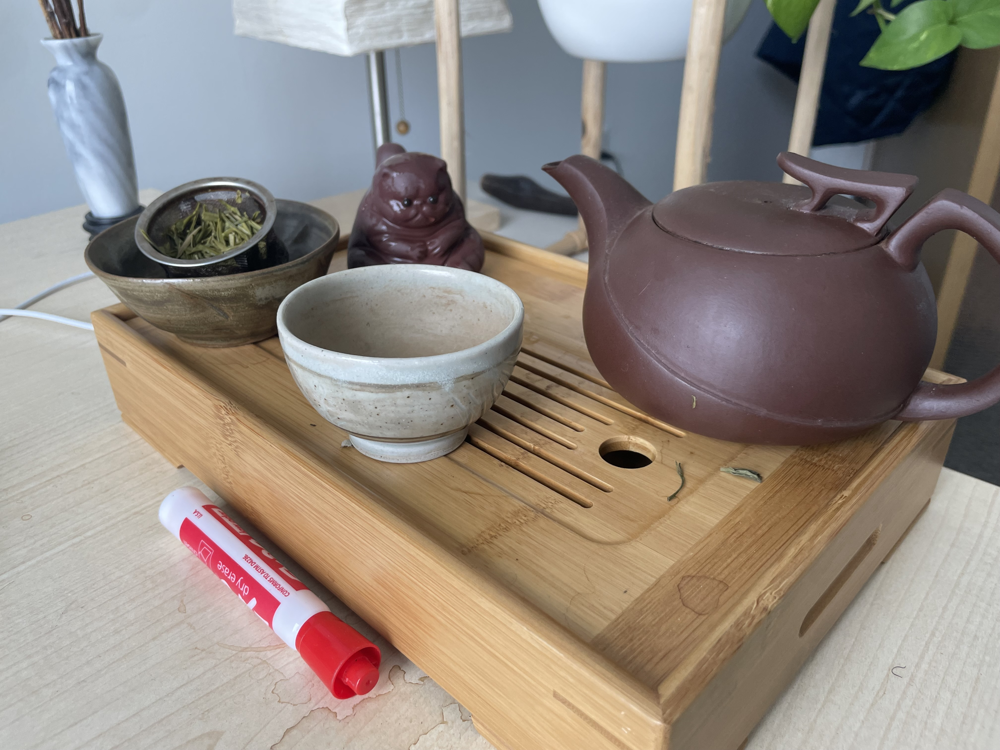{.absolute right=12% top=52% width=25.5%}
{.absolute right=12% top=73% width=25.5%}

::: 

## {.split-50}


::: {.column}

### On a scale from 0-5, how's this talk?

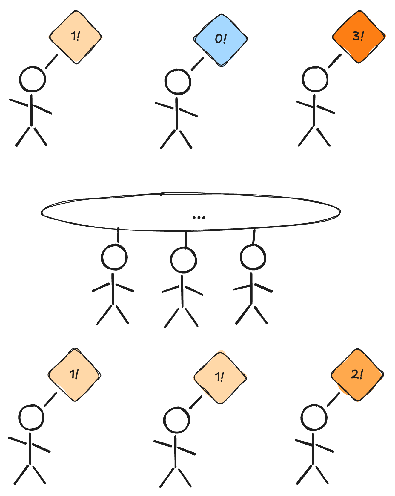{.fragment width="80%" height="80%" fig-align="center"}

<!-- White rectangles to incrementally reveal this fig -->

::: {.r-stack .fragment .fade-out .absolute top=340 left=10}
<!-- A simple styled box or rectangle -->
<div style="background: #ffffff; width: 800px; height: 800px; border-radius: 8px;"></div>
:::

::: {.r-stack .fragment .fade-out .absolute top=500 left=10}
<!-- A simple styled box or rectangle -->
<div style="background: #ffffff; width: 800px; height: 800px; border-radius: 8px;"></div>
:::

:::

::: {.column}

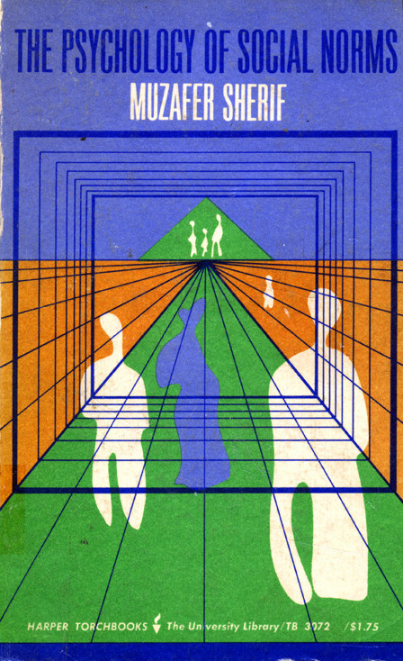{.absolute top=0 left=0 width="100%" height="100%" .fragment}

:::

## {background-color="black"}

<br> <br> <br> <br> <br> <br> <br> <br> <br> 

::: {.r-stack}

::: {data-id="box1" style="background: #ffffff; width: 10px; height: 10px; border-radius: 200px;"}

:::


<!--  -->

:::

<br><br><br>

[***Autokinetic effect***: a still point of light in a dark room will appear to move if you stare at it long enough.]{.fragment}


## "So, how far did the light move?" 

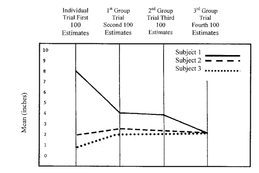{fig-align="center" width="90%"}

[Sherif (1935)]{.footnote}


## "So, how far did the light move?" 

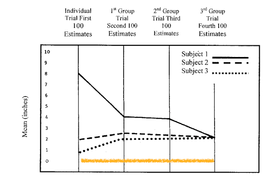{fig-align="center" width="90%"}

[Sherif (1935)]{.footnote}


## Social Influence

::: {.textblock-3 .standout}

*Any [change]{.alert-1} in an individual’s thoughts, feelings, or behaviors caused by [other people]{.alert-2}, who may be actually present or whose presence is imagined, expected, or only implied.*
<br><br>
\- American Psychological Association (APA) Dictionary of Psychology, 2026

:::

::: {.fragment}
Models of social influence address: 

- [Which other people?]{.alert-2}
- [What kind of change?]{.alert-1}

:::


## Towards Formalization: [Which Other People?]{.alert-2}


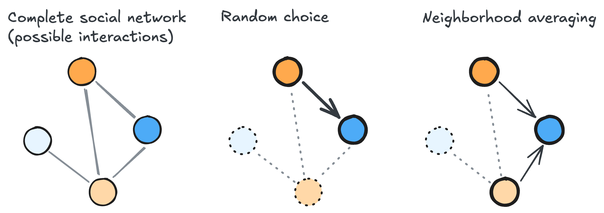{width="80%" height="80%" fig-align="center"}

::: {.r-stack .fragment .fade-out .absolute top=200 left=480}
<!-- A simple styled box or rectangle -->
<div style="background: #ffffff; width: 400px; height: 800px; border-radius: 8px;"></div>
:::

::: {.r-stack .fragment .fade-out .absolute top=200 left=780}
<!-- A simple styled box or rectangle -->
<div style="background: #ffffff; width: 400px; height: 800px; border-radius: 8px;"></div>
:::

## Towards Formalization: [What Kind of Change?]{.alert-1} {#model-kernel}

<!-- TODO: At the bottom of this slide add a citaiotn to Sherif, Taub and Hovland (1958) -->
::: {.gap-lead}
<br>
:::

::::::: {.panel-row .kernel-row}
:::: {.panel-col}
[Discrepancy]{.panel-head}

::: {.r-stack}
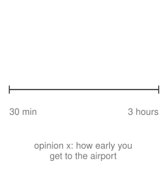

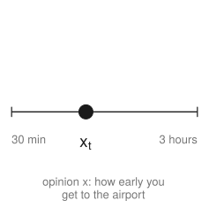{.fragment fragment-index=1}

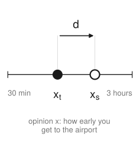{.fragment fragment-index=2}

<!-- []{.absolute top=0 right=0 width=100% height=100% .fragment-index=2}
[]{.absolute top=0 right=0 width=100% height=100% .fragment-index=3} -->

:::

[0 inches]{style="font-size: 1.5rem; color: #666666; background-color: #ffffff;" .absolute bottom=270 left=50}
[10 inches]{style="font-size: 1.5rem; color: #666666; background-color: #ffffff;" .absolute bottom=270 left=270}
[Opinion x: how much <br>has the dot moved?]{style="font-size: 1.5rem; color: #666666; background-color: #ffffff;" .absolute bottom=170 left=75}

::: {.panel-cap}
[$x_t$: opinion of the target]{.fragment fragment-index=1 .cap-line}
[$x_s$: opinion of a source at discrepancy $d$]{.fragment fragment-index=2 .cap-line}
:::
::::

:::: {.panel-col .fragment fragment-index=3}
[Kernel]{.panel-head .influence}

::: {.r-stack}
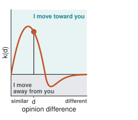

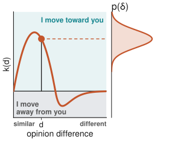{.fragment fragment-index=4}
:::

::: {.panel-cap}
The kernel $k(d)$ sets how far the target moves

[$\delta = k(d) + \text{noise}$]{.fragment fragment-index=4 .update-eq}
:::
::::

:::: {.panel-col .fragment fragment-index=5}
[Outcome]{.panel-head}

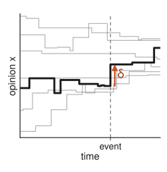

::: {.panel-cap}
The target's opinion moves by $\delta$
:::
::::
:::::::

[Slide h/t Will Thompson]{.ht}


::: notes
- 2026-10-11: kernel panel is now a mostly attractive kernel with a shallow repulsive dip (x(0.45-x), damped past the zero crossing at d = 0.45, dip about a quarter of the peak; x axis "similar" to "different") with the #bipolarization shading: top half "I move toward you", bottom half "I move away from you". Scaled so k(d) at d = 0.3 equals the World's mean move (0.21), so p(delta) shares the kernel's y axis. The toy numbers below about the sigmoid gain describe the old curve; the outcome panel still uses that run (same mean move at d, so the jump is consistent).
[WILL: one dyad, built up in six clicks. Start from the opinion line [0, 1]; (1) the target's opinion x_t; (2) a source x_s at discrepancy d. (3) The kernel k(d) says how far the target moves at that discrepancy. (4) The update: delta = k(d) + noise, a move toward the source plus zero-mean noise. (5) Outcome: the target's opinion moves by delta, one step in a trajectory. This is the paper's hero, piece by piece; retention and selection get added to it later]

Facts, with sources:

- Notation: this slide absorbs both lambda and d into k, so the slide's k(d) is the paper's lambda k(|d|) d, the expected move. d = x_s - x_t. Linear (DeGroot) is a straight line through the origin, k(d) = lambda d. If asked: "in the paper k is a gain, and we split it into a scale lambda and a shape". Every later slide uses the same k(d): #explanations and the hero kernel panels (#model-attention, #model-hero) draw the move against the discrepancy, not the gain [scripts/talk/scenes/_hero.py kernel_panel].
- Toy numbers: x_t = 0.40, x_s = 0.70, d = 0.30, paper gain k(|d|) = 0.92, lambda = 0.75, so k(d) = 0.21 is the mean move; sigma = 0.035. The paper gain here is a sigmoid with half-point 0.6 and steepness 0.12, wider than the hero's World (0.35, 0.07), so d sits on the rising flank of k [scripts/talk/scenes/_scene.py, World; panels/model_kernel.py].
- The density p(delta) is scaled so its centre sits level with k(d) on the kernel [panels/model_kernel.py, kernel()].
- The paper writes the update as delta_e ~ q(. | mu, eta) with mu = lambda k(|d_e|) d_e [Overleaf sections/method_v2.tex:52]; "noise" on the slide is q.
- The noise around the mean move is one of the paper's noise families; the talk holds it fixed (Laplace in the paper's selected models) [paper Methods].
:::


## A first model: random neighbor choice and linear influence


DeGroot or *linear* kernel (DeGroot 1974): $k(d) = \lambda d$.

<br> <br> <br> <br> <br> <br> <br> <br> <br> <br> <br> <br> 


::: {.absolute top="3%" right="0%"}
```{r}
#| fig.width: 3
#| fig.height: 2

expand.grid(
  d = seq(0, 1, length.out = 100),
  lambda = c(0.1, 0.5, 0.9)
) |>
  tibble() |>
  mutate(k = lambda * d) |>
  ggplot() + 
  geom_line(aes(x = d, y = k, color = factor(lambda)), size=1.5) +
  scale_color_viridis_d() +
  theme_minimal() +
  labs(x = expression(italic(d)), y = expression(italic(k(d))), color = expression(lambda)) 
```
:::


{.absolute top="30%" left="0%" .fragment}

::: {.absolute top="30%" right="0%" .fragment}
```{r}
#| echo: false
#| fig.width: 6
#| fig.height: 4

library(tidyverse)


set.seed(1234)

x = c(0.5, 2, 8)
A = matrix(c(0, 1, 1,
             1, 0, 1,
             1, 1, 0), nrow=3, byrow=TRUE)
lambda = 0.4

df = tibble(t = 0, agent = 1:3, opinion = x)
for(t in 1:3){
  old_x <- x
  for(i in 1:3){
    j <- setdiff(1:3, i) |> sample(1)
    x[i] <- old_x[i] + lambda * (old_x[j] - old_x[i]) + rnorm(1, 0, 0.05)
  }
  df <- bind_rows(df, tibble(t=t, agent=1:3, opinion=x))
}

df |> ggplot() +
  geom_line(data=df, aes(x=t, y=opinion, linetype=factor(agent)), size=1.5) +
#   scale_color_manual(values=c("#d0bfff", "#fa5252", "#ffc9c9")) +
  theme_minimal() +
  theme(legend.position="none") +
  labs(x="Model timestep", y="Opinion") + 
  scale_y_continuous(limits=c(0, 10)) +
  scale_linetype_manual(values=c("dotted", "dashed", "solid")) + 
  ggtitle("Linear influence with random neighbor choice and Gaussian noise")
```

:::

[Across a broad range of model choices, linear influence with $\lambda > 0$ tends to produce consensus.]{.fragment}


## {background-image="../_img/kernel-inference/polarized-report.png" background-size="contain" background-position="center" background-repeat="no-repeat"}


## Many Kernels, Many Mechanisms {#explanations}

:::: {.panel-row .shapes-row}
::: {.panel-col}
[Linear]{.panel-head .influence}

[Compromise --> consensus]{.panel-sub}

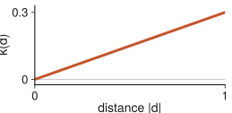

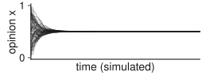

[convergence]{.panel-dyn}

::: {.cites-wrap}
[Empirical justification]{.cites-label}

::: {.cites}
- Vande Kerckhove et al. 2016
- Takács et al. 2016
- Clemm von Hohenberg et al. 2017
- Friedkin & Bullo 2017
- Friedkin et al. 2021
:::
:::
:::

::: {.panel-col .fragment fragment-index=1}
[Repulsion]{.panel-head .influence}

[Compromise with similar opinions, repulsed by distant opinions]{.panel-sub}

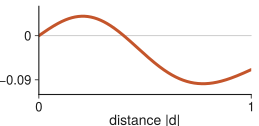

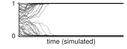

[polarization]{.panel-dyn}

::: {.cites-wrap}
::: {.cites}
- Mazen & Leventhal 1972
- van Knippenberg et al. 1990
- Krizan & Baron 2007
- Liu & Srivastava 2015
:::
:::
:::

::: {.panel-col .fragment fragment-index=2}
[Bounded confidence]{.panel-head .influence}

[Compromise with similar opinions, ignore distant opinions]{.panel-sub}

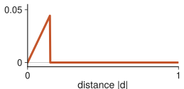

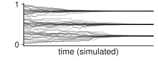

[clusters]{.panel-dyn}

::: {.cites}
- Moussaïd et al. 2013
:::
:::
::::

<!-- ::: {.explain-punch .dissensus-punch .fragment fragment-index=3}
So, which of these is "right"?
::: -->

::: {.attn-box .attn-box-influence .fragment .fade-in-then-out fragment-index=4}

Or do it nonparametrically!

```{r}
#| fig.width: 6
#| fig.height: 4
#| echo: false
#| fig.align: "center"
fit_rff <- function(X, n_components = 100, gamma = 1.0) {
  n_features <- ncol(X)
  
  # For RBF kernel, sample weights from Normal(0, 2 * gamma)
  sd_w <- sqrt(2 * gamma)
  W <- matrix(rnorm(n_features * n_components, mean = 0, sd = sd_w), 
              nrow = n_features, ncol = n_components)
  
  # Sample biases uniformly from [0, 2 * pi]
  b <- runif(n_components, min = 0, max = 2 * pi)
  
  return(list(W = W, b = b))
}

#' Transform Data using Fitted RFF
#' @param X Matrix of data to transform.
#' @param rff_model The list object returned by fit_rff.
#' @return Matrix of explicit random Fourier features.
transform_rff <- function(X, rff_model) {
  # Linear projection: X %*% W
  projection <- X %*% rff_model$W
  
  # Sweep adds the bias vector 'b' to each row of the projection matrix
  projection_with_bias <- sweep(projection, 2, rff_model$b, "+")
  
  # Compute the final feature map: sqrt(2 / D) * cos(XW + b)
  Z <- sqrt(2 / ncol(rff_model$W)) * cos(projection_with_bias)
  return(Z)
}

X <- matrix(runif(1000, min = 0, max = 3), ncol = 1)
y <- abs(sin(0.1 * pi * X) + rnorm(1000, sd = 0.1))

# X <- matrix(seq(0, 1, length.out = 100), ncol = 1)
rff_model <- fit_rff(X, n_components = 100, gamma = 3)
Z <- transform_rff(X, rff_model)

data_train <- data.frame(y = y, Z)
lm_model   <- lm(y ~ ., data = data_train)

y_pred <- predict(lm_model, newdata = data_train)

df_to_plot <- data.frame(x = X[, 1], y_pred = y_pred)
df_to_plot |> 
  ggplot(aes(x = x, y = y_pred)) +
  geom_line(color="#C4552B", linewidth=2) +
  theme_minimal() +
  labs(x = expression(italic(d)), y = expression(italic(k(d)))) +
  ggtitle("Random Fourier Feature Kernel") +
  theme(legend.position = "none") + 
  ylim(0, NA)
```

[Rahimi + Recht (2007)]{.attn-caption}

<br><br><br>

:::


::: notes
[WILL: the first models said influence is linear: DeGroot, a flat kernel, every update a fixed fraction of the gap. Run that and everyone meets. Our world does not look like that; it is dominated by dissensus and polarization. So what kernel makes this world? Each kernel shape is a hypothesis about why we disagree, and each has its backers. Walk the columns left to right: the shape, who reports it, and the world it makes. Linear pulls everyone together; repulsion pushes far opinions away and leaves two poles; bounded confidence stops listening past a radius and leaves clusters. Same kind of experiment, every possible answer. Last click: no one agrees on the shape]

Three clicks: repulsion column, bounded confidence column, then the punch line. (2026-10-11: order swapped from BC then repulsion.)

Facts, with sources:

- One curve per column, drawn as influence k(d) (each column on its own y scale; bounded confidence peaks at 0.045, just inside its radius), from the paper's gain functions: DeGroot k = 1, the diagonal; hard bounded confidence, radius 0.15 (full gain inside, zero beyond: Deffuant/Hegselmann-Krause); SAR with crossover 0.4 [presentations/ccs_2026/panels/explanations.py; kernel_inference/paper_figures/kernel_gains.py].
- Bottom row is simulated, not data: 60 agents, each step every agent hears one agent drawn at random and moves 0.3 k(d), clipped to [0, 1], 80 steps, seed 1. Linear ends in consensus, bounded confidence in clusters, repulsion in two poles at the edges [same].
- Citations are Kozitsin (2021) Table 1, "Studies testing influence assumptions against real data", by its three columns: linear positive, moderated positive, positive + negative. All approved (+) except Krizan & Baron 2007, which rejected the positive + negative hypothesis. Kozitsin's footnotes, dropped from the slide: Mazen & Leventhal 1972 ignores trends in opinion shifts; van Knippenberg et al. 1990 does not separate in-group and out-group influence; Liu & Srivastava 2015 is nonlinear, with an increasing rate [~/Zotero/storage/2Q4MVCCW, Table 1].
- Column headings are ours: Kozitsin's "moderated positive" is influence that fades with distance, which is the bounded confidence shape; "positive + negative" is assimilation near, repulsion far.

Literature (verified 2026-10-05 against the papers where reachable; otherwise the manuscript):

- Takács, Flache & Mäs 2016, PLoS ONE 11(6):e0157948: "positive and rather linear" (Study 1, distance coefficient 0.34); "We did not find support for the negative influence hypothesis." One manuscript sentence (background.tex:10) calls Takács bounded confidence; that contradicts the paper.
- Vande Kerckhove et al. 2016, PLOS ONE 11(6):e0157685: constant influenceability alpha per player; bounded confidence only mentioned as an alternative.
- Kozitsin 2021, J. Math. Sociol. 46(1): positive shifts "largely through a linear form or an inverted U-shaped form", hence in two columns. Its negative shifts "may be partially explained ... without referring to the notion of repulsive influence".
- Deffuant et al. 2000; Hegselmann & Krause 2002: step kernels, theory only. DeGroot 1974: constant gain, theory. Noise destroys BC clusters: Pineda, Toral & Hernández-García 2009 [not re-verified].
- Moussaïd et al. 2013, PLOS ONE 8(11):e78433: "Social influence is negligible when opinions are initially too distant." The far zone is fading influence, not repulsion.
- Sherif, Taub & Hovland 1958: assimilation near the anchor, contrast far from it. Latitudes of acceptance are Sherif & Hovland 1961, not 1958.
- Adams et al. 2022, PLOS ONE 17(10):e0275473: the manuscript (introduction.tex:4) says it observed repulsive dynamics, reported as an anomaly. The paper itself tests the Martins model. [WILL: check before saying this out loud]
- If asked about backfire in the field: Bail et al. 2018 (PNAS); failures to find it: Wood & Porter 2019, Guess & Coppock 2020 [not re-verified]. Mäs & Flache 2013, PLoS ONE 8(11):e74516: "bi-polarization can be explained without negative influence".
- Becker et al. 2017 left off: no kernel-shape claim found.

Folded in from the dissensus slide (#why-dissensus, now in backup), which showed a DeGroot consensus run against a bounded-confidence dissensus run and a tangle of candidate kernels with a question mark:

- Its trajectory panels are simulated, not data: 60 agents, each step every agent hears one agent drawn at random and moves 0.3 k(d), clipped to [0, 1], 80 steps, seed 1. DeGroot, k = 1, ends in consensus. Sigmoidal bounded confidence (sharpness 200, squared radius 0.05, so radius 0.22) ends in two groups near 0.31 and 0.79, away from the edges: dissensus without extremes [panels/why_dissensus.py]. The linear column's dynamics panel on this slide is the same consensus run.
- DeGroot in the paper's notation: k(|d|) = 1, so the mean move is lambda d.
- Its tangle of candidate kernels was illustrative: sigmoidal BC at four radii, SAR at four crossovers, an inverted U and a concave decline; not a list of fitted kernels [panels/why_dissensus.py, CANDIDATES].
- Picture options if the slide gets real data later: Voteview's party means over time, or a protest photo shot from a distance with no identifiable faces.
:::

[Slide h/t Will Thompson]{.ht}


## {.split-50}

#### [How do we learn the kernel from data?]{.absolute-header}

::: {.column}

<br> <br> 

Easiest case: for each $i$ there is only one neighbor $j$. 

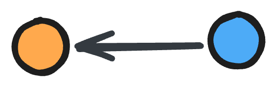{width="50%" height="50%" fig-align="center"}

$$
\begin{aligned}
  x_i(t+1) - x_i(t)
    &=  k(|d|) + \text{noise}\\ 
    d &= x_j(t) - x_i(t)
\end{aligned}
$$

:::

::: {.column}

<br> 

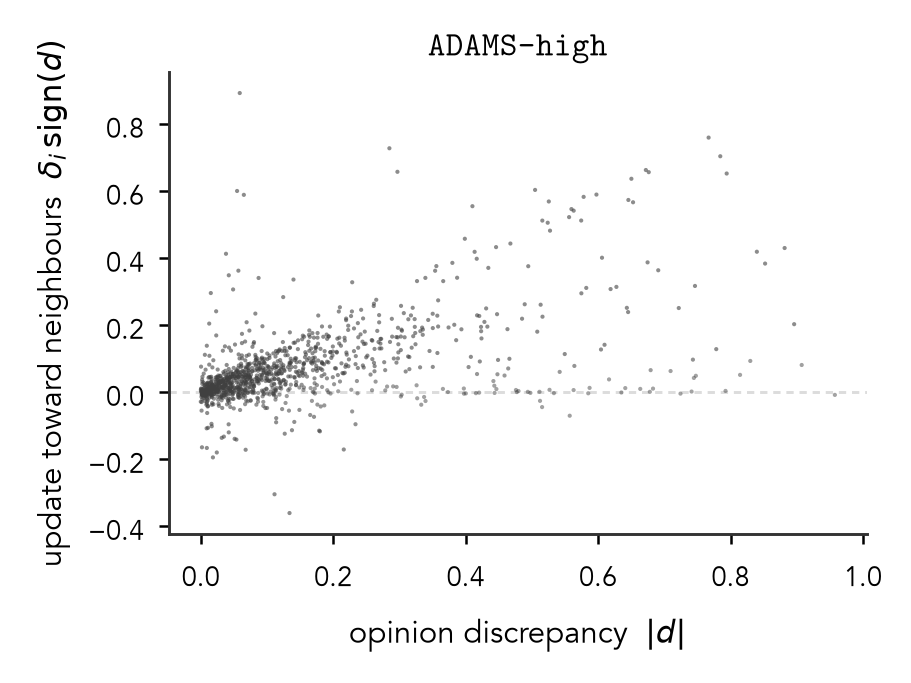{fig-align="center" .bordered-fig}

[Adams, White, and Araujo (2022). "Person-to-person opinion dynamics: An empirical study using an online game." *PLoS ONE*.]{.footnote}

:::


## 


{.absolute top=30 right=150 width="30%" .bordered-fig}


## {background-image="../_img/kernel-inference/is-this-a.jpeg" background-size="contain" background-position="center" background-repeat="no-repeat" background-color="black"}


{.absolute top=30 right=150 width="30%" .bordered-fig}

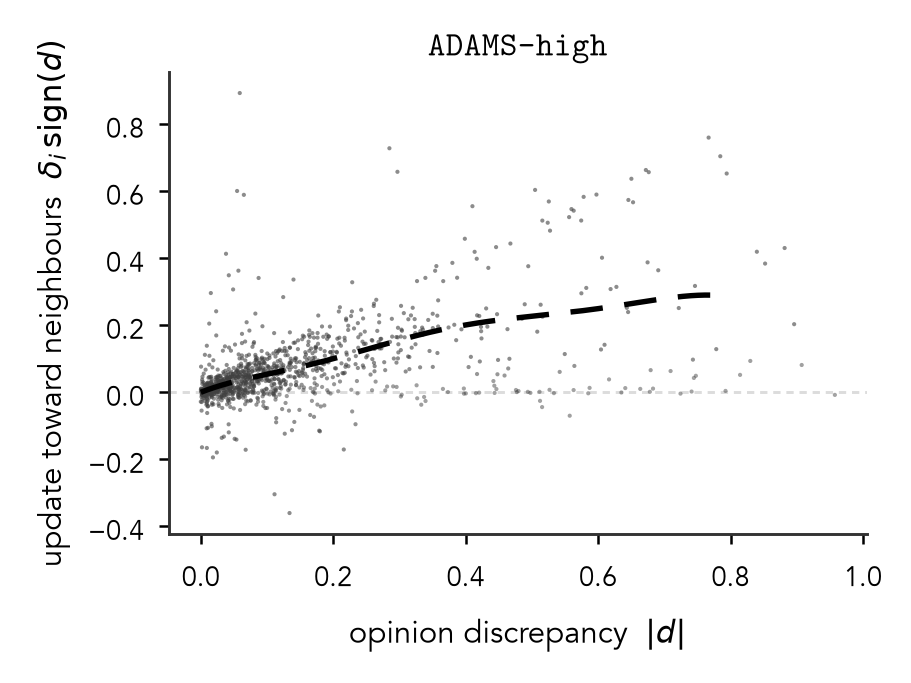{.absolute top=30 right=150 width="30%" .fragment .bordered-fig}


## {.split-30}

#### [A more complex case: multiple neighbors]{.absolute-header}

::: {.column}

<br>

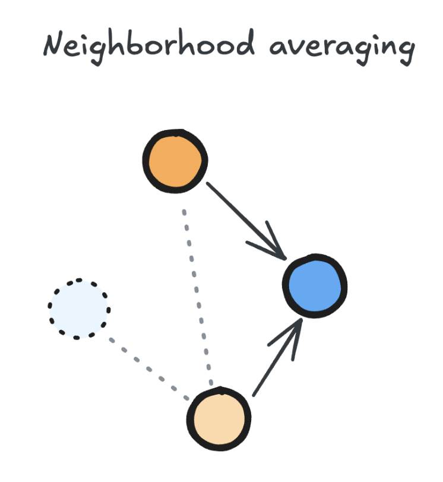{width="100%" height="100%" fig-align="center"}
$$
\begin{aligned}
  \delta_i
    &\approx  \frac{1}{|\partial i|} \sum_{j \in \partial i} k(d_{ij}) \;?\\
  \delta_i &\approx k\left(
\frac{1}{|\partial i|} \sum_{j \in \partial i} d_{ij}
  \right) \;?
\end{aligned}
$$

:::

::: {.column}

<br> 

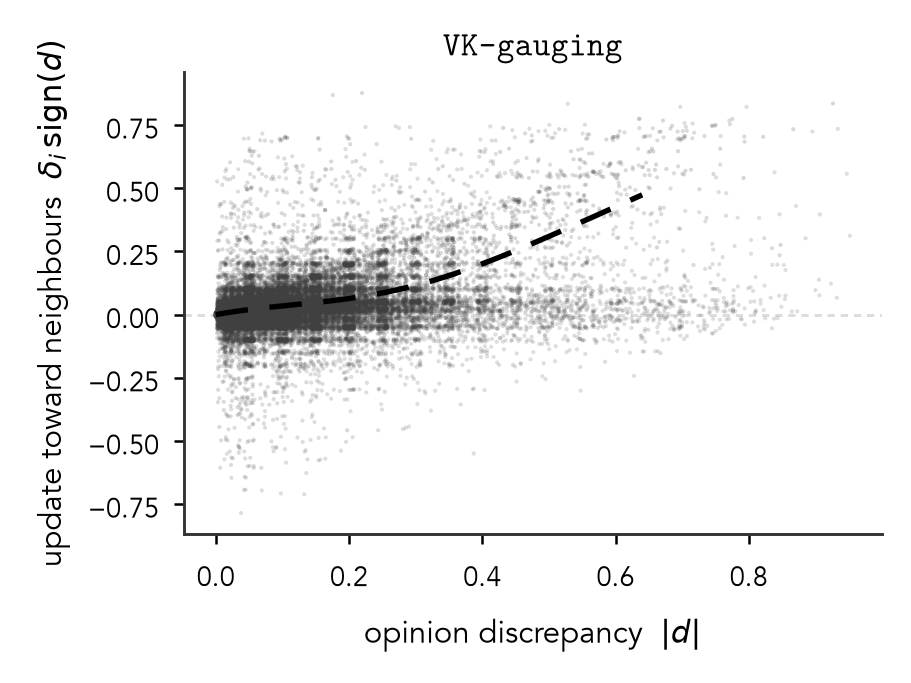{width="70%" fig-align="center" .bordered-fig}

[Vande Kerckhove + al. (2016). "Modelling Influence and Opinion Evolution in Online Collective Behaviour." *PLoS ONE*.]{.footnote}

:::


## {.split-40}

### [Some common implicit assumptions]{.absolute-header}

::: {.column}

<br> <br> <br> 


[
  At each timestep <br> 
  each agent [***always***]{.alert-1}  interacts <br> 
  with [***all***]{.alert-2} of their neighbors.
]{style="font-size: 1.5em;"} 


:::

::: {.column}

<br>


$$
\begin{aligned}
  \delta_i
    &\approx  \frac{1}{|\partial i|} \sum_{j \in \partial i} k(d_{ij}) \;?
  \quad \delta_i \approx k\left(
\frac{1}{|\partial i|} \sum_{j \in \partial i} d_{ij}
  \right) \;?
\end{aligned}
$$


{width="50%" height="0%" fig-align="center"}

::: 

## {.split-50}

### [Core idea for today: selective attention]{.absolute-header}

::: {.column} 

<br> <br> 

[
  At each timestep <br> 
  each agent [***~~always~~ sometimes***]{.alert-1} interacts <br> 
  with [***~~all~~ some***]{.alert-2} of their neighbors.
]{style="font-size: 1.5em;"} 


::: {.attn-box .attn-box-influence .fragment .fade-in-then-out fragment-index=4}

This is complex because we typically *don't observe* these attentional mechanisms: we only observe the opinion changes that result. 

:::


:::

::: {.column}

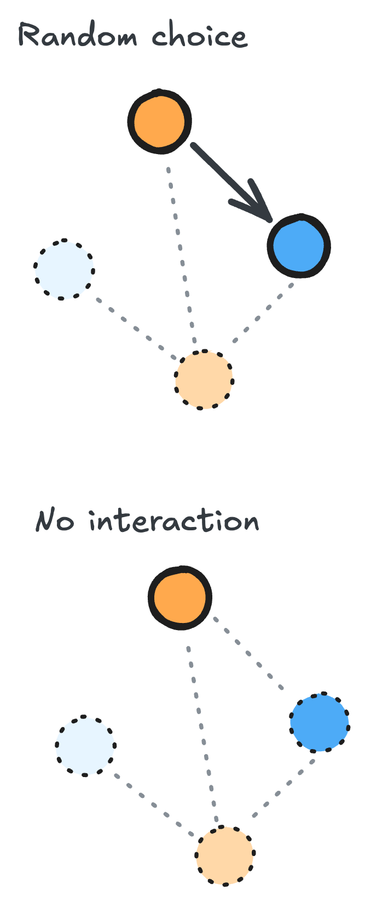{width="40%" height="40%" fig-align="center"}

:::


## The Team


<table style="padding:0px; border-bottom:0px; margin: 0px auto; width: 100%;">
<tr style="border:0px;padding:0px;margin:0px;">
<td style="padding:0px;border-bottom:0px"> 
{.portrait-small} 
</td>
<td style="vertical-align: middle;white-space:nowrap;padding:0px;border-bottom:0px">
<p style="padding:0px">**Will Thompson** <br> UVM</p>
</td>

<td style="vertical-align: middle;padding:0px;border-bottom:0px"> 
{.portrait-small} 
</td>
<td style="vertical-align: middle;white-space:nowrap;padding:0px;border-bottom:0px">
<p style="padding:0px">**Moyi Tian** <br> CU Boulder</p>
</td>


<td style="vertical-align: middle;padding:0px;border-bottom:0px"> 
{.portrait-small} 
</td>
<td style="vertical-align: middle;white-space:nowrap;padding:0px;border-bottom:0px">
<p style="padding:0px">**Linh Huynh** <br> Texas Tech</p>
</td>

<tr>

<td style="vertical-align: middle;padding:0px;border-bottom:0px"> 
{.portrait-small} 
</td>
<td style="vertical-align: middle;white-space:nowrap;padding:0px;border-bottom:0px">
<p style="padding:0px">**Alex Wiedemann** <br> Hamline University</p>
</td>


<td style="vertical-align: middle;padding:0px;border-bottom:0px"> 
</td>
<td style="vertical-align: middle;padding:0px;border-bottom:0px"> 
</td>

<td style="vertical-align: middle;padding:0px;border-bottom:0px"> 
{.portrait-small} 
</td>
<td style="vertical-align: middle;white-space:nowrap;padding:0px;border-bottom:0px">
<p style="padding:0px">**Vicki Modisette** <br> Eastern Kentucky</p>
</td>


</tr>

<tr>
<td style="vertical-align: middle;padding:0px;border-bottom:0px"> 
{.portrait-small} 
</td>
<td style="vertical-align: middle;white-space:nowrap;padding:0px;border-bottom:0px">
<p style="padding:0px">**Phil Chodrow** <br> Middlebury College</p>
</td>

<td style="vertical-align: middle;padding:0px;border-bottom:0px"> 
</td>
<td style="vertical-align: middle;padding:0px;border-bottom:0px"> 
</td>


<td style="vertical-align: middle;padding:0px;border-bottom:0px"> 
{.portrait-small} 
</td>
<td style="vertical-align: middle;white-space:nowrap;padding:0px;border-bottom:0px">
<p style="padding:0px">**Heather Brooks** <br> Harvey Mudd</p>
</td>

</tr>

</table>

{.absolute top=300 right=490 width=25% .fragment fragment-index=1}

::: {.textblock-1  .fragment fragment-index=1}

Work initiated at the AMS Mathematics Research Community on *Complex Social Systems* (2023)!

:::


<!-- 

### 

## 

### Visualizing Retention

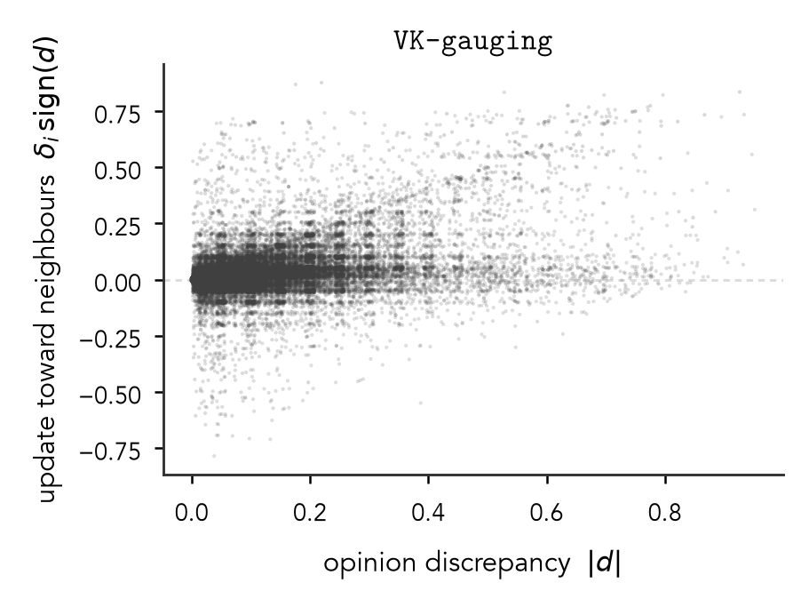{.absolute top=110 left=150 width="60%"}
{.fragment .absolute top=110 left=150 width="60%"}
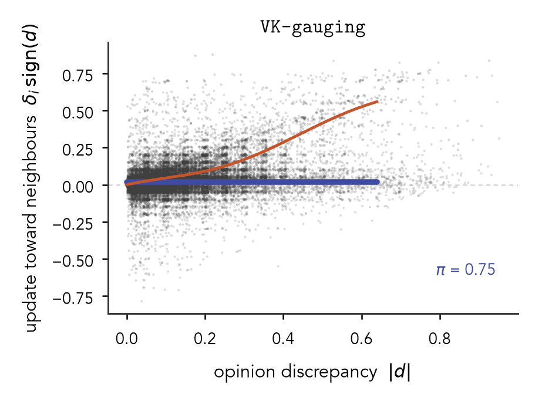{.fragment .absolute top=110 left=150 width="60%"}

[Vande Kerckhove + al. (2016). "Modelling Influence and Opinion Evolution in Online Collective Behaviour." *PLoS ONE*.]{.footnote} -->
<!-- 

## 

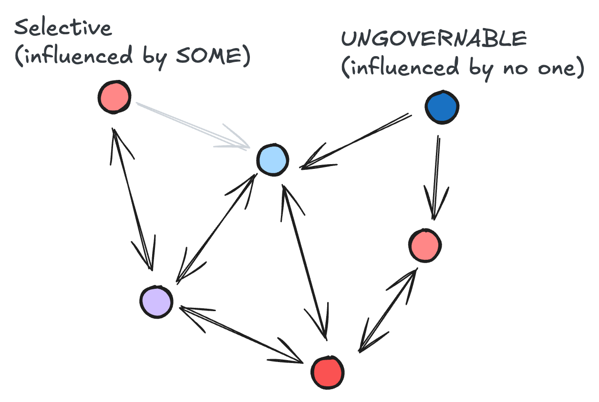{width="100%"} -->


## Three Innovations {#model-attention}


::: {.attn-fig}
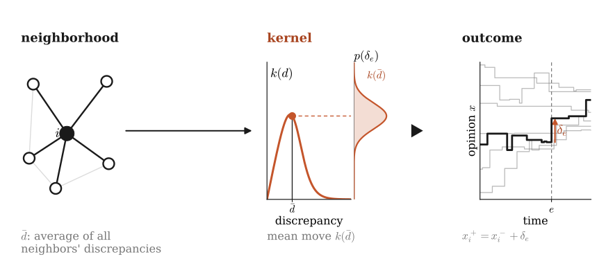{aria-label="The usual model averages over all neighbors"}

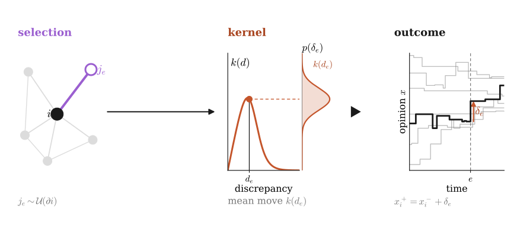{.fragment fragment-index=2 aria-label="Selection: one neighbor is chosen"}

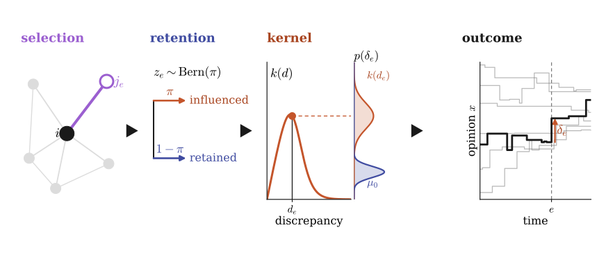{.fragment fragment-index=5 aria-label="Retention: a gate decides whether influence occurs"}

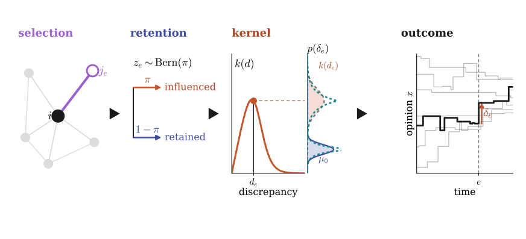{.fragment fragment-index=8 aria-label="Gaussian and Laplace update noise"}

::: {.attn-pop .fragment .fade-in-then-out fragment-index=7}
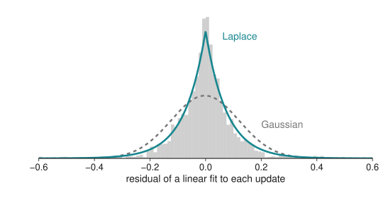{aria-label="Adams update residuals and fitted noise distributions"}

Adams 2022, n = 3,760 updates
:::

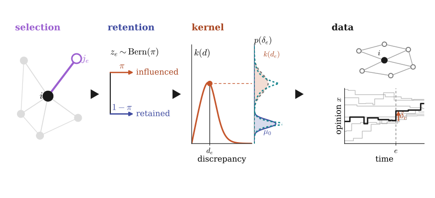{.fragment .attn-wide fragment-index=9 aria-label="The mechanisms shrink and the observed data appear"}

{.fragment fragment-index=10 aria-label="Unobserved mechanisms and observed data"}

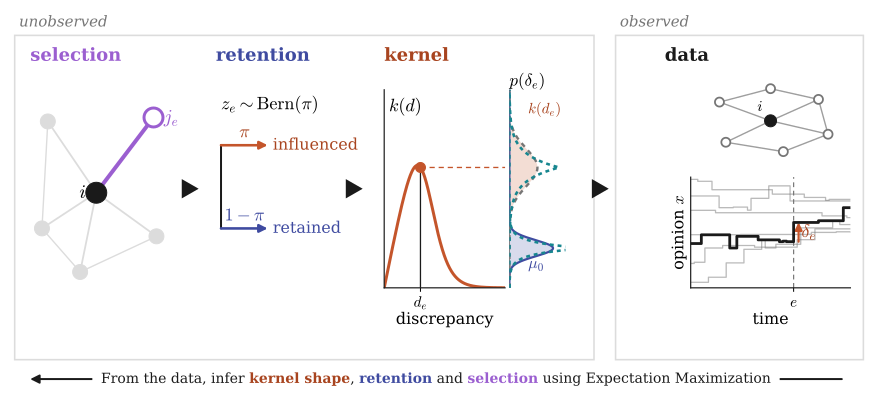{.fragment fragment-index=11 aria-label="EM infers kernel shape, retention, and selection"}
:::

:::: {.attn-cols .fragment .fade-out fragment-index=9}

::: {.attn-col}
[**Standard:** average over *all* neighbors]{.attn-trad}

[**Novel:** listen to *one* neighbor, chosen at random]{.attn-sol .attn-sel .fragment fragment-index=2}
:::

::: {.attn-col}
[**Standard:** you always update]{.attn-trad .fragment fragment-index=3}

[**Novel:** sometimes you don't]{.attn-sol .attn-ret .fragment fragment-index=5}
:::

::: {.attn-col}
[**Standard:** Gaussian noise (least-squares methods)]{.attn-trad .fragment fragment-index=6}

[**Problem:** real updates often appear heavy tailed]{.attn-prob .fragment fragment-index=7}

[**Novel:** select among noise models like [Laplace]{.attn-lap} or [Gaussian]{.attn-gau}]{.attn-sol .attn-noise .fragment fragment-index=8}
:::

::::

::: {.attn-box .attn-box-sel .fragment .fade-in-then-out fragment-index=1}
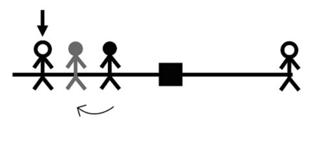{aria-label="Kozitsin 2021: a move toward one neighbor can look like a move away from the neighborhood mean"}

[After Kozitsin (2021)]{.attn-caption}

[I can move **toward** a neighbor but **away** from the neighborhood average]{.attn-box-take}
:::

::: {.attn-box .attn-box-ret .fragment .fade-in-then-out fragment-index=4}
::: {.attn-box-pair}
::: {.attn-example}
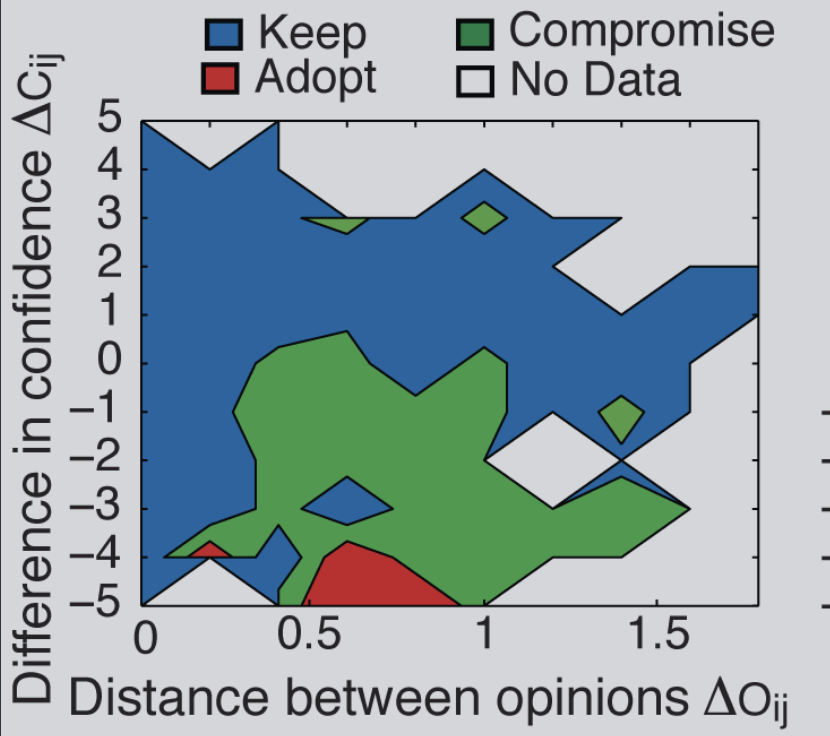{aria-label="Keep, compromise, and adopt across opinion distance and confidence"}

[Moussaïd et al. (2013): far apart, people keep their opinion]{.attn-caption}
:::

[→]{.attn-box-arrow}

::: {.attn-example}
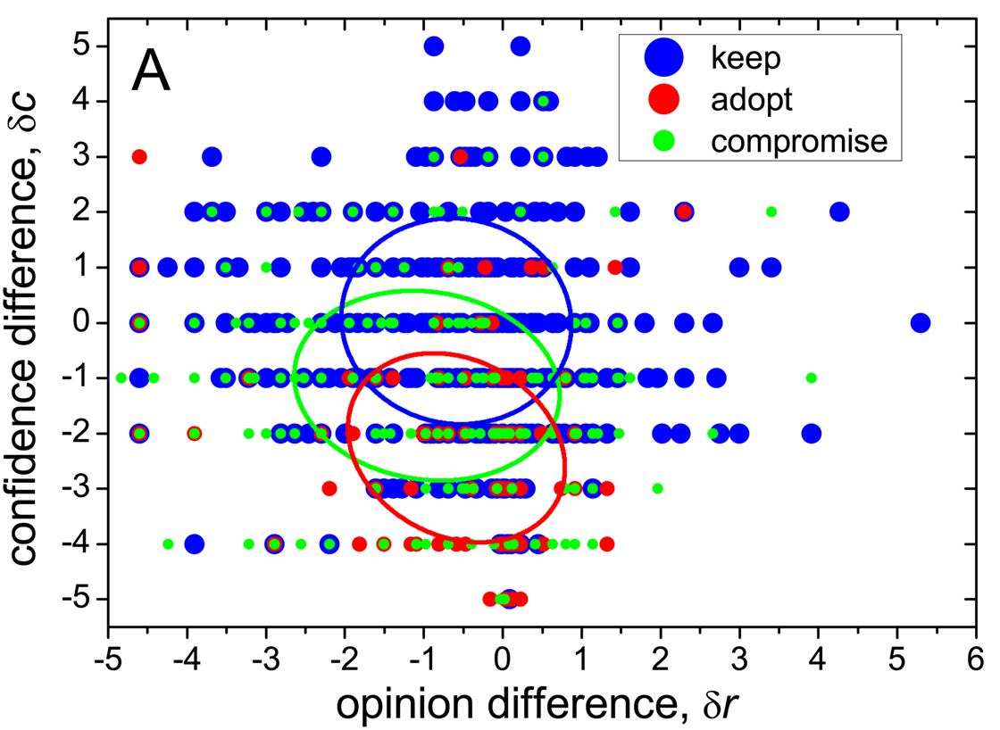{aria-label="Keep, adopt, and compromise overlap at every opinion difference"}

[Chacoma & Zanette (2015): keeping happens at every distance]{.attn-caption}
:::
:::

[Ignore retention and the kernel looks like **bounded confidence**]{.attn-box-take}
:::

::: notes
[WILL, 2026-10-11 night: #attention-confounds merged back into this slide. Say the old lead aloud at the start: "Many studies have pointed out ways attention can be confounded with kernel shape. But it is rarely included in models, because it cannot be directly measured." Click 1: the selection box pops up at the bottom: "I can move toward a neighbor but away from the neighborhood average" (Kozitsin cartoon; say aloud that averaging therefore fakes repulsion). Click 2: it goes, selection solution. Click 3: retention traditional. Click 4: the retention box (Moussaid says far apart people keep; Chacoma & Zanette show keeping at every distance; ignore retention and you see bounded confidence). Click 5: it goes, retention solution and the gate. Noise and fit beats unchanged. The click numbers below predate this and are otherwise still right.]

[WILL: one slide for both latent mechanisms (was #model-selection-only + #model-retention, both now in backup). Opens on the averaging model with "Traditional method" under selection. Click 1: the averaging problem. Click 2: the scene switches to selection, with the solution. Clicks 3-5: the same three beats under retention, and the gate appears with the retention solution. Clicks 6-8: the same beats under the kernel column for noise. Click 7 pops the Adams residual histogram over the figure; click 8 hides it and draws a Gaussian (grey) and a Laplace (teal) dotted over p(delta). Click 9: the text goes, the figure shrinks and the data come in on the right, the network and the opinion time series. Click 10: unobserved and observed boxes. Click 11: the EM arrow back from the data to kernel shape, retention and selection. The goal card that used to be click 12 is now its own slide, #goal, right after this one. 2026-10-11: the selection and retention "Problem" lines (old clicks 1 and 4) moved to #attention-confounds, the slide before, so every click number above after 0 is now one or two lower; reveal compacts the gaps. 2026-10-11 late: column text trimmed to a few words each (was full sentences, e.g. "latent neighbor selection. Every time step the agent chooses one neighbor uniformly at random to listen to"); say the long versions aloud. Removed text: "Problem: an agent can move toward a neighbor but away from the average, creating spurious repulsion (Kozitsin 2021; Mäs & Flache 2013)" and "Problem: behavior is better modeled as a probabilistic mixture of retention and influence (Chacoma & Zanette 2015)"]

Facts, with sources:

- Moussaid et al. 2013, PLOS ONE 8(11):e78433: "Social influence is negligible when opinions are initially too distant." Regions keep / compromise / adopt over opinion distance and confidence. Figure number not re-verified [planning/history_figures.md item 8]. CC BY 4.0.
- Chacoma & Zanette 2015, PLOS ONE 10(10):e0140406, Fig. 2A: keep / adopt / compromise over opinion difference and confidence difference, overlapping ellipses. "opinion changes are not influenced by the initial difference with the reference opinion". CC BY 4.0.
- Kozitsin 2021 (J. Math. Sociol.): negative shifts "may be partially explained ... without referring to the notion of repulsive influence". Mäs & Flache 2013, PLoS ONE 8(11):e74516: "bi-polarization can be explained without negative influence". [WILL: confirm which Kozitsin paper and figure number the cartoon is]
- Caveat if pressed: in our synthetic 2x2, omitting retention mostly shrinks the kernel (by about pi) and only sometimes fakes bounded confidence; omitting selection smooths the kernel, and the "fake repulsion" there is a repulsive truth whose zero crossing moves, not repulsion from nothing [#hypotheses notes; #mech-retention notes].
- Built from backup slides #retention-why (Moussaid + Chacoma), #selection-why (Kozitsin cartoon) and the flash illustrations on #omission-flow.
- Figures are the existing hero stages, cropped to the selection, retention and kernel columns (the outcome panel is cut by .attn-fig in styles/components.scss): scene_hero_selection steps 1-2, scene_hero_retention step 2 [scripts/talk/scenes/scene_hero_selection.py, scene_hero_retention.py].
- Averaging can look like repulsion: Kozitsin 2021 (J. Math. Sociol.): negative shifts "may be partially explained ... without referring to the notion of repulsive influence"; Mäs & Flache 2013, PLoS ONE 8(11):e74516: "bi-polarization can be explained without negative influence".
- Clicks 9-11 are scene_hero_attn_fit [scripts/talk/scenes/scene_hero_attn_fit.py], drawn at the hero's coordinates so stage 1 lies exactly on the noise stage; the shrink is the .attn-fig crop window opening up (styles/components.scss). The network is the toy graph the time series were simulated on (scene_data.EDGES), focal i in black as its trace.
- Noise popup is the #noise slide's histogram with both fits [assets/panels/noise/fits.svg]: Adams, n = 3,760 updates, excess kurtosis about 10. The Laplace there is the ML fit, the Gaussian the moment fit.
- On the scene the two dotted curves share the influence bump's mean and variance (Laplace scale sigma/sqrt 2), so the only difference is shape: a sharper peak and fatter tails [scripts/talk/scenes/scene_hero_noise.py].
- Chacoma & Zanette 2015, PLOS ONE 10(10):e0140406: keep, adopt and compromise overlap in opinion distance, so each response is a draw from a mixture of modes; the probability of keeping rises with relative confidence, not distance.
- Toy numbers as on the old slides: uniform choice of j_e is the model's prior; pi = 0.6, retention arm N(mu_0 = 0, 0.015) drawn wider than a real spike [scripts/talk/scenes/_scene.py, World].
- Exact-zero updates are removed before fitting, not modelled; the retention arm sees only near-zero moves [paper Table 1 caption and App. D].
:::

[Slide h/t Will Thompson]{.ht}


## {.split-50}

::: {.column}

### Learning the model 

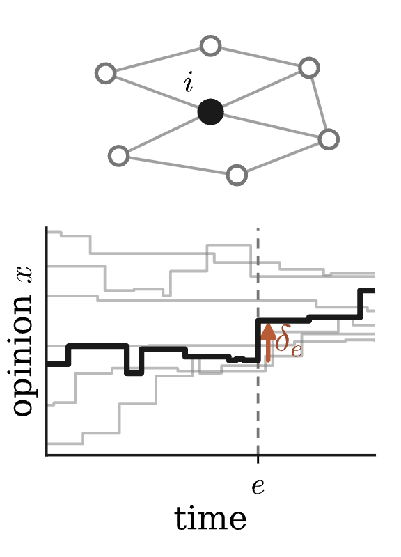{width="70%" fig-align="center"}

:::

::: {.column}

<br> 

::: {.textblock-1}

Our stochastic model defines a [likelihood function]{.alert-1} over observed opinion trajectories, given an observation of a fixed network of possible interactions. 

:::

<br>

::: {.textblock-2}

We learn the kernel parameters by maximizing this likelihood via the [expectation-maximization (EM) algorithm]{.alert-2} (Dempster et al., 1977).

:::

<br>

::: {.textblock-3}

We [select between competing models]{.alert-3} (kernels, mechanisms, etc.) by evaluating their predictive likelihoods on held-out validation data. 

:::

:::


## Omitting retention and neighbor selection alters learned kernels


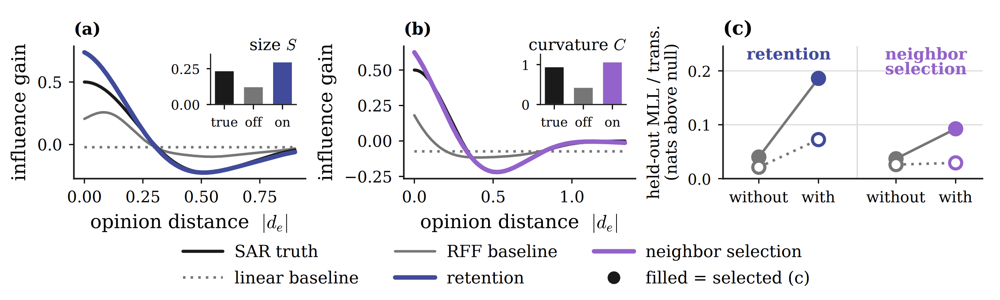{.bordered-fig}


## Our Data {#data-specimens .markdown-source}

::: {.specimen-grid}
[Controlled, single source]{.spec-type .fragment fragment-index=1}

[Controlled, network]{.spec-type .fragment fragment-index=2}

[Social media]{.spec-type .fragment fragment-index=3}

[Prediction markets]{.spec-type .fragment fragment-index=4}

[Congress]{.spec-type .fragment fragment-index=5}

::: {.spec-name .fragment fragment-index=1}
ADAMS  
[lab, pairs · also TAKACS, BECKER]{.spec-detail}
:::
::: {.spec-name .fragment fragment-index=2}
VK-counting  
[lab, groups of six · also VK-gauging]{.spec-detail}
:::
::: {.spec-name .fragment fragment-index=3}
CMV  
[Reddit threads · also SPINOS, VKontakte]{.spec-detail}
:::
::: {.spec-name .fragment fragment-index=4}
MARKETS  
[Manifold]{.spec-detail}
:::
::: {.spec-name .fragment fragment-index=5}
SENATE  
[roll calls, cosponsorship · also HOUSE]{.spec-detail}
:::

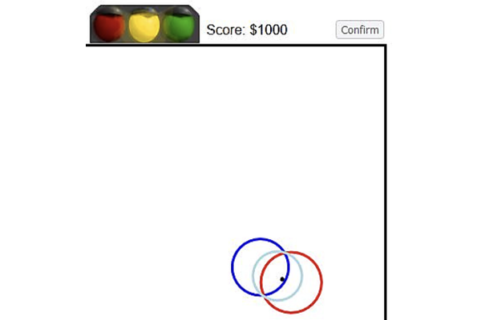{.spec-raw .fragment fragment-index=1 aria-label="Adams experiment"}

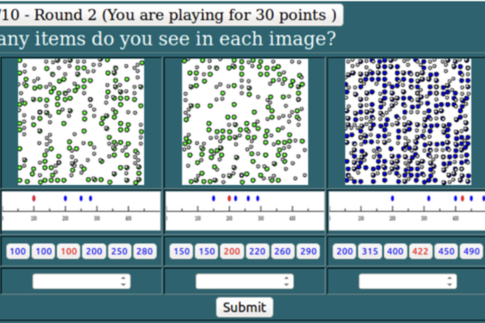{.spec-raw .fragment fragment-index=2 aria-label="VK counting experiment"}

{.spec-raw .fragment fragment-index=3 aria-label="Change My View thread"}

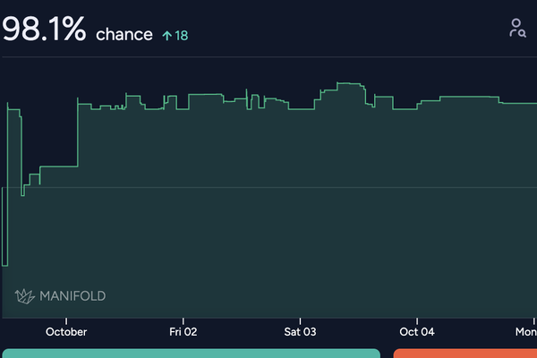{.spec-raw .fragment fragment-index=4 aria-label="Manifold market"}

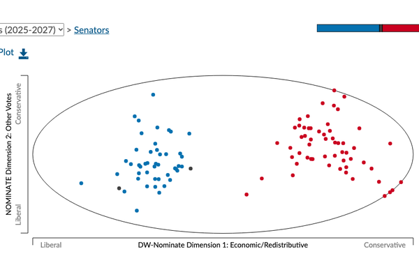{.spec-raw .fragment fragment-index=5 aria-label="Senate roll calls"}

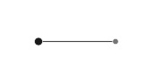{.spec-net .fragment fragment-index=1 aria-label="Adams pair network"}

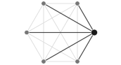{.spec-net .fragment fragment-index=2 aria-label="VK group network"}

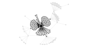{.spec-net .fragment fragment-index=3 aria-label="Change My View reply network"}

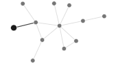{.spec-net .fragment fragment-index=4 aria-label="Manifold reply network"}

{.spec-net .fragment fragment-index=5 aria-label="Senate cosponsorship network"}

::: {.spec-group .spec-lab .fragment fragment-index=2}
::: {.spec-brace}
:::
controlled lab experiments
:::

::: {.spec-group .spec-wild .fragment fragment-index=5}
::: {.spec-brace}
:::
the social wilds
:::
:::

::: notes
[WILL: five very different worlds; each click brings in one whole column (screenshot and network; the opinion-trace row was dropped 2026-10-11, the svgs are still in assets/figures/datasets/*_x.svg). The punch at the end: to us they are all the same object, a network and opinion traces, and an event is one agent's x before and after while we see everyone else's x]

Reading the panels: the black agent is one focal agent; its edges are black, the agents it sees grey, everyone else faint (greyscale since 2026-10-11; FOCAL in scripts/draw_specimens.py). Same grammar in every column.

Facts, with sources (exporters in `presentations/ccs_2026/scripts/specimen_*.py`, panels drawn by `draw_specimens.py`):

- ADAMS: Adams et al. 2022 (PLOS ONE), the Moussaid 2013 estimation game. The participant places a circle, sees a partner's (red) circle, places again. Panel plots |x|, the distance to the partner, before and after: nearly every line slopes down. One update per pair. 40 random pairs of 3,760. ADAMS splits into low/medium/high by the red circle's reliability (20/50/80%). [WILL: confirm what the traffic light in the screenshot shows]
- VK-counting: Vande Kerckhove et al. 2016 (PLOS ONE). Six players count dots over three rounds and see the others' previous estimates. x = count / 500. One median group (gameset 61, image 4); true count dashed. Fully connected group of 6.
- CMV: r/ChangeMyView. x = classifier stance of a commenter's latest stance-bearing comment. The near 0/1 jumps are the classifier saturating, not people flipping that hard. Network: largest reply component of the thread (126 of 281 commenters); traces for the 15 most active. Screenshot thread is not the plotted one; plotted thread is the median of the 9 threads rebuildable offline.
- MARKETS: Manifold. x = a trader's implied probability at their latest bet; network is who replied to whom. Median market by event count (101 events, 12 traders, 6 trade). Screenshot is a different market, cropped to the price chart.
- SENATE: sim 118633. Network: cosponsorship pairs (>= 3 shared bills, Congresses 108-119), Serrano disparity backbone at alpha = 0.10; 232 senators, 1,600 edges, largest component drawn. x = Nokken-Poole first-dimension score per Congress (not DW-NOMINATE: Nokken-Poole lets a member move between Congresses). Focal: median |mean score| among the 13 senators who served all 12 Congresses. The House panel (118639) is built the same way. Screenshot: Voteview's 119th Senate DW-NOMINATE plot (credit voteview.com).
- Screenshots: from Will's Keynote and Voteview; CMV usernames blurred; the Manifold title is cropped off because it names a private person.

From the roster slide (#data-roster, back in the main deck right after this one, with the full table of panels, node and event counts): the "also" names under each column are the sibling panels in the same setting.

- Known single source: ADAMS, TAKACS, BECKER. A few sources: VK-gauging, VK-counting. Many sources: SENATE, HOUSE, MARKETS, SPINOS, VKontakte, CMV [paper Results, dataset paragraph].
- ADAMS has three subsets by the red circle's reliability (low, medium, high = 20/50/80%), a property of the source, not the participant's confidence [plan 01_plan.md §1.1; CLAUDE.md panel table].
- TAKACS has two studies; Study 2 has the within-subject disliking treatment [paper Results, dataset paragraph].
- The ladder has 15 rows, not 16 [plan 01_plan.md §6 Q3, §7].
- Open wording: "11 studies, 15 panels" vs "12 datasets, 15 panels" [plan 01_plan.md §6 Q5]. [WILL: the title says fifteen panels; confirm the count you want to say out loud]
:::

[Slide h/t Will Thompson]{.ht}


## Impact of Attentional Mechanisms {#ladder-intro}

*Example: Senate political opinions*

::: {.r-stack .ladder-stack}


{.fragment fragment-index=1}

{.fragment fragment-index=2}

{.fragment fragment-index=3}
:::

::: {.ladder-nest aria-label="Nested models: baseline, heavy tail, latent retention, latent selection"}
[latent selection]{.nest-selection .fragment fragment-index=3}

[latent retention]{.nest-retention .nest-off .fragment fragment-index=2}

[heavy tail]{.nest-tail .fragment fragment-index=1}

[baseline]{.nest-base}
:::

[Adding attention changes our conclusion about the shape of the kernel!]{.fragment fragment-index=3}


::: notes
[WILL: the circles on the left are the nesting: each rung contains the one before it, so a rung can only fit as well or better. WILL: introduce the ladder on one panel. Start from the classical model, then switch on one capability at a time: heavy-tailed noise, latent retention, latent selection. At every rung we fit both a linear kernel and a flexible one (RFF) and score them on held-out data. On the Senate the linear kernel wins until selection is switched on, and then the flexible kernel wins: the verdict on shape depends on which mechanisms you allow]

Facts, with sources:

- Source: figure_data/nonlinearity_by_rung_rff.json, panel senate, rungs 2 to 5 (baseline = rung "2 + best kernel": Gaussian noise, one arm, mean-field neighbours). Drawn by panels/ladder_intro.py.
- y is held-out MLL per update minus the rung-0 null (0.876). Solid: best RFF model with at most that rung's capabilities. Dashed: best DeGroot in the same feasible set (degroot_mll). Filled marker: the higher raw held-out score; no test.
- SENATE above null, linear vs RFF: baseline 0.020 vs 0.001; heavy tail 0.170 vs 0.159; retention 0.170 vs 0.164 (linear unchanged, retention adds nothing for DeGroot on SENATE); selection 0.174 vs 0.192.
- Gaps are small at some rungs (0.006 nats at retention). The ladder figure and the nonlinearity scatter make the cross-panel claims.
- Alternatives on the same file: HOUSE flips at every rung (L, NL, L, NL) but its gaps are under 0.005 nats until selection, so the two lines overlap; PLOS counting is L, L, L, NL like SENATE.
:::

[Slide h/t Will Thompson]{.ht}

<!-- ===== 32_results_ladder ===== -->

## Latent mechanisms make models more predictive {#results-ladder}

<!-- TODO: Add pictograms of best fit kernel shapes back to each section of the bar -->

<!-- TODO: change the VK-gausing to the Senate data -->

:::::: {.panel-row .ladder-row}
::::: {.panel-col}
::: {.r-stack}


{.fragment fragment-index=1}

{.fragment fragment-index=3}

{.fragment fragment-index=4}

{.fragment fragment-index=6}

{.fragment fragment-index=7}

{.fragment fragment-index=8}

{.fragment fragment-index=10}

{.fragment fragment-index=11}
:::
:::::
::::: {.panel-col .lc-stage}
:::: {.ladder-text .fragment .fade-out fragment-index=3}
::: {}
One bar per dataset: its held-out gain over a random-walk null, segmented into mechanisms by order of addition. 
:::

::: {.fragment fragment-index=1}
[Influence kernel]{.panel-head style="color: #767676;"}
Presence of any social influence (rather than random drift)
:::


::: {.fragment fragment-index=1}
[Heavy tail]{.panel-head .tail}
Selected on 13/15 datasets; on average 28% more predictive power per update.
:::

::: {.fragment fragment-index=1}
[Latent retention]{.panel-head .retention}
Selected on 13/15 datasets; on average 21% more.
:::

::: {.fragment fragment-index=1}
[Latent selection]{.panel-head .selection}
Selected on 6/8 networked datasets; on average 8% more.
:::

::: {.ladder-final .fragment fragment-index=2}
On average, heavy tails, retention and selection tend to matter *more* than the actual kernel shape!
:::
::::

:::: {.lc-card .fragment .fade-out fragment-index=8}
::: {.r-stack}
{.fragment fragment-index=3}

{.fragment fragment-index=4}

{.fragment fragment-index=6}

{.fragment fragment-index=7}
:::
::::

:::: {.lc-nlq}
::: {.r-stack}
{.fragment fragment-index=5}

{.fragment fragment-index=6}

{.fragment fragment-index=7}

{.fragment .lc-up fragment-index=8}

{.fragment fragment-index=10}

{.fragment fragment-index=11}
:::
::::

:::: {.lc-verdict}
::: {.fragment fragment-index=9}
**Adding attention makes**
:::

::: {.fragment fragment-index=9}
the model more predictive (on heldout data!) on **14/15** datasets
:::

::: {.fragment fragment-index=10}
the inferred kernel **less linear** on **6/15** (upper left)
:::

::: {.fragment fragment-index=11}
the inferred kernel **more linear** on **2/15** (lower right)
:::
::::
:::::
::::::

::: notes
[WILL, second half (clicks 3-11): the text goes and we walk the ladder one dataset at a time. SENATE: its bar lit up to selection, and the card shows the fit without selection, a linear kernel on the neighbour average. Click: the selection segment, and the card shows the hump the neighbour average hid. Click: its point on the scatter, x the kernel alone, y with the mechanisms; it sits upper left, linear without, nonlinear with. BECKER: retention was shrinking the influence arm; once unmixed it is steeper and curves up, upper left too. ADAMS-high: the stayers made a fake falloff, so with retention it is linear, lower right. Then every dataset, and the verdict]

Second-half build (panels/ladder_cases.py, reusing capability_ladder.py, cases.py, arms.py and nl_quadrants.py):

- Clicks: 3 text out, SENATE bar up to selection (baseline + tail + retention) + card without the mechanism; 4 SENATE full bar + card with selection and its tag; 5 SENATE on the scatter; 6 BECKER (bar, card, point); 7 ADAMS-high; 8 all bars back, card out, every point, scatter slides up; 9 verdict line 1; 10 line 2 + upper-left shaded and its bars lit on the ladder (ladder_ul); 11 line 3 + lower-right shaded and its bars lit (ladder_br). The lit rows come from the same quadrant test as the scatter (nl_quadrants.quadrant).
- 2026-10-11: card tags now read in the direction of adding attention, matching the scatter: BECKER and SENATE "more nonlinear" (influence ink), ADAMS-high "more linear" (grey). The taxonomy boxes ("Magnitude of influence shrinks", "Curvature of the kernel shrinks", "Spurious bounded confidence") were removed; say them aloud if wanted. Tags live in panels/ladder_cases.py TAG; cases.py BOX (omission direction) is unchanged for the backup #cases slide.
- Card dashed line = winner at the rung just before the mechanism (BECKER and ADAMS-high rung 3, which already has the heavy tail; SENATE rung 4), as on the old #cases slide (now in backup). 2026-10-12: SENATE now leads (was BECKER), so the slow three-click build is SENATE's; its _base state lights every segment below selection, so the lit bar and the card's dashed rung-4 fit agree (ladder_cases.py BASE_STEPS).
- Scatter: held-out MLL per update, RFF minus DeGroot; x at the baseline rung (kernel alone, rung 2), y at the top rung with every selected mechanism, including the heavy tail. Same numbers as #nl-quadrants (backup). TAKACS-S2-control is off the top, drawn as an arrow. Raw held-out comparison, no test.
- 14/15: retention or selection step above selection.TIE_NATS (1e-3) on every panel but SPINOS [capability_ladder_dg_rff.json]. 6/15 upper left: BECKER, TAKACS-S2-disliking, SENATE, VK-counting, TAKACS-S1, HOUSE. 2/15 lower right: ADAMS-high, CMV. Several are near-ties (HOUSE x is -.0004, TAKACS-S1 x is -.0009, VK-counting y is +.004).

[WILL: what each capability buys in held-out likelihood, all 15 panels, one bar each. Open on SENATE alone: the classical model buys 2% over the null, the heavy tail another 16%, retention nothing, selection 2%; the factors multiply to 1.21x. The pictogram in each segment is the selected kernel at that rung: linear until selection, where the curve bends. Then reveal each mechanism on every dataset and read off the right-hand line]

How the right-hand numbers are computed (drawn by panels/capability_ladder.py from figure_data/capability_ladder_dg_rff.json; same 15 rows as the paper figure, takacs_disliking_interior dropped):

- A step's value is deviance per transition, so its log likelihood ratio is value / 2 and its "% more" is exp(value / 2) - 1: the factor by which that step multiplies the per-update held-out likelihood.
- "Selected on" = step value above selection.TIE_NATS (1e-3) out of the panels where the step exists; raw held-out comparison, no test. Selection exists only on the 8 networked panels.
- "On average" = geometric mean over the panels where it is selected: exp(mean(value) / 2) - 1. Arithmetic means are dragged by CMV (retention alone is x3.2 there): 26% / 29% / 10%. Medians: tail 25%, retention 5%, selection 2%.
- Heavy tail 13/15 (zero on CMV, SPINOS), +28%. Retention 13/15 (zero on SPINOS; SENATE is +0.00004, under the tie), +21%. Selection 6/8 (zero on SPINOS, VKontakte), +8%.
- SENATE segment labels are shares of the total gain, rounded to sum to 100: baseline 10%, tail 78%, retention 0% (3.9e-5 deviance, under the tie; the blue tile is the pictogram's backing, not a real segment), selection 12%, total 1.21x. As "% more" per update those are +2, +16, +0, +2%.
- Pictograms: the paper's (fig_capability_ladder kernel_curves + bar_segments), drawn as influence r k(r): dotted diagonal = linear, curve = r times the fold-mean RFF G_grid, each scaled to its own tile.
- Build: SENATE alone, then click 1 jumps straight to every bar complete with all three mechanism lines (the tail-only and retention-only states are no longer shown), click 2 the closing line.
- Closing line: averaged over the 15 rows, the latent mechanisms (tail + retention + selection) carry 65% of each panel's gain over the null; the kernel-shape step alone (RFF over DeGroot at the baseline rung) carries 0.7%, and influence plus shape together 35%. Mechanisms beat influence plus shape on 11/15 (not on TAKACS-S2-control, TAKACS-S2-disliking, BECKER, SPINOS) [capability_ladder_dg_rff.json, steps clipped at 0, mean of per-panel shares].
- Strictly these are gains over the previous rung, not over the null; the factors multiply to the total over the null.

Dropped stage claims, from fig_capability_ladder.stages.json (full six-stage build in backup, #backup-ladder-build): stage 1, "How to read a bar: the share of the held-out log likelihood ratio over the random-walk null, left to right as capabilities switch on; the total is the per-transition likelihood multiplier." Stage 2, "The classical model, influence plus kernel shape, alone: its share runs from 0.6% on VKontakte to 98% on SPINOS."

Facts, with sources:

- Step 1, SENATE row: shares 0.10 / 0.78 / 0.00 / 0.11 of its gain, total 1.21x [figure_data/capability_ladder_dg_rff.json; plan 01_plan.md §3.2].
- Baseline share runs from 0.6% (VKontakte) to 98% (SPINOS) [fig_capability_ladder.stages.json step 2; capability_ladder_dg_rff.json].
- Laplace over Gaussian is selected on 13 of 15 panels (not on CMV and SPINOS per the ladder JSON) and is the largest segment on 9 [fig_capability_ladder.stages.json step 3; capability_ladder_dg_rff.json]. The paper text says "all but two of 15" [paper Results, heavy-tailed paragraph]; note the paper's own margin comment says Laplace is slightly selected on CMV.
- Retention adds on 13 of 15 panels (zero on SENATE and SPINOS) [capability_ladder_dg_rff.json; fig_capability_ladder.stages.json step 4]. DISCREPANCY: the paper prose says 14 of 15 [paper Results, "Latent retention is a common feature"]; write 13/15 until the prose is fixed.
- Retention share: CMV 63% of its gain, VKontakte 42% [fig_capability_ladder.stages.json step 4].
- Selection beats aggregation on 6 of 8 networked panels, an approximate tie on the other two (VKontakte, SPINOS) [paper Results, source selection paragraph; capability_ladder_dg_rff.json]. Shares: CMV 22%, SENATE 12%, HOUSE 9% [paper Results; plan 01_plan.md §3.2].
- Totals: CMV 6.26x, VKontakte 2.90x, ADAMS-high 2.03x, SPINOS 1.08x [fig_capability_ladder.stages.json step 5].
- ADAMS: estimated response probability 78% (ADAMS-high, red circle 80% reliable) vs 44% (ADAMS-low, 20% reliable) [paper Results, retention paragraph]. The paper calls it "retention rate"; per the plan it is pi-hat, the probability of a social response [plan 01_plan.md §6 Q4].
- SPINOS: no retention, no selection, lambda not distinguishable from zero [paper Results, source selection paragraph].
- Pictograms show the fitted kernel at each step; vertical scales are normalised per dataset [paper Fig. explained_deviance caption].
:::

[Slide h/t Will Thompson]{.ht}

## Some Learnings {.split-40}

::: {.column}

<br>

::: {.textblock-1 .fragment .fade-in-then-semi-out fragment-index=1}

[Potential exposure $\neq$ interaction]{.alert-1}

In experiments and online settings, relationship networks (proximity, following, etc.) define *possible* rather than *actual* interactions. 

:::

::: {.textblock-2 .fragment .fade-in-then-semi-out fragment-index=2}

[Model latent variables]{.alert-2}

We can model what we don't observe directly: we just need to tie it statistically to things that we do observe. 

:::


::: {.textblock-3 .fragment .fade-in-then-semi-out fragment-index=3}

[Attentional mechanisms]{.alert-3}

Even simple representations of attention can improve prediction and alter our conclusions. 

:::

:::

::: {.column}

{.fragment fragment-index=1  .fade-in-then-out .absolute top="5%" left="25%" width="30%" }


{.fragment fragment-index=2 .fade-in-then-out .absolute top="27%" left="0%" width="98%"}

{.fragment fragment-index=3 .fade-in-then-out .absolute top="7%" left="0%" width="95%"}


:::


## Thanks everyone! {.split-40}

::: {.column}

<br>

{.bordered-fig}

::: {.absolute bottom="15%" right="25%"} 

[arxiv:2610.12616](https://arxiv.org/abs/2610.12616)

:::

:::

::: {.column}


<br><br>

<table style="padding:0px;border-bottom:0pxmargin: 0px auto; ">
<tr style="border:0px;padding:0px;margin:0px;">
<td style="padding:0px;border-bottom:0px"> 
{.portrait-smallish} 
</td>
<td style="vertical-align: middle;white-space:nowrap;padding:0px;border-bottom:0px">
<p style="padding:0px">**Will Thompson** <br> UVM</p>
</td>

<!-- </tr>
<tr style="border:0px;padding:0px;margin:0px;"> -->

<td style="vertical-align: middle;padding:0px;border-bottom:0px"> 
{.portrait-smallish} 
</td>
<td style="vertical-align: middle;white-space:nowrap;padding:0px;border-bottom:0px">
<p style="padding:0px">**Moyi Tian** <br> CU Boulder</p>
</td>

</tr>
<tr style="border:0px;padding:0px;margin:0px;">


<td style="vertical-align: middle;padding:0px;border-bottom:0px"> 
{.portrait-smallish} 
</td>
<td style="vertical-align: middle;white-space:nowrap;padding:0px;border-bottom:0px">
<p style="padding:0px">**Linh Huynh** <br> Texas Tech</p>
</td>

<!-- </tr>
<tr style="border:0px;padding:0px;margin:0px;"> -->

<td style="vertical-align: middle;padding:0px;border-bottom:0px"> 
{.portrait-smallish} 
</td>
<td style="vertical-align: middle;white-space:nowrap;padding:0px;border-bottom:0px">
<p style="padding:0px">**Alex Wiedemann** <br> Hamline University</p>
</td>

</tr>
<tr style="border:0px;padding:0px;margin:0px;">


<!-- </tr>
<tr style="border:0px;padding:0px;margin:0px;"> -->

<td style="vertical-align: middle;padding:0px;border-bottom:0px"> 
{.portrait-smallish} 
</td>
<td style="vertical-align: middle;white-space:nowrap;padding:0px;border-bottom:0px">
<p style="padding:0px">**Vicki Modisette** <br> Eastern Kentucky</p>
</td>


<!-- </tr>
<tr style="border:0px;padding:0px;margin:0px;"> -->

<td style="vertical-align: middle;padding:0px;border-bottom:0px"> 
{.portrait-smallish} 
</td>
<td style="vertical-align: middle;white-space:nowrap;padding:0px;border-bottom:0px">
<p style="padding:0px">**Heather Brooks** <br> Harvey Mudd</p>
</td>

</tr>

</table>

{.absolute bottom="13%" right="28%" width="20%"}
{.absolute bottom="10%" right="53%" width="20%"}

:::


