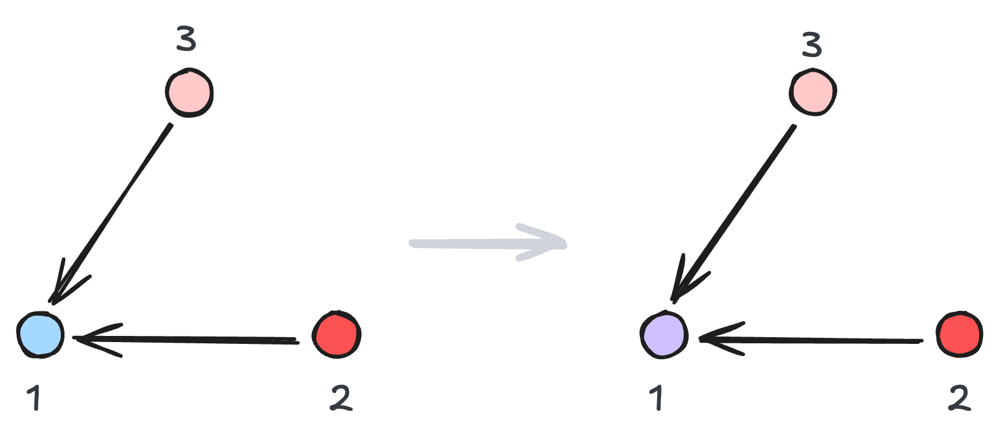
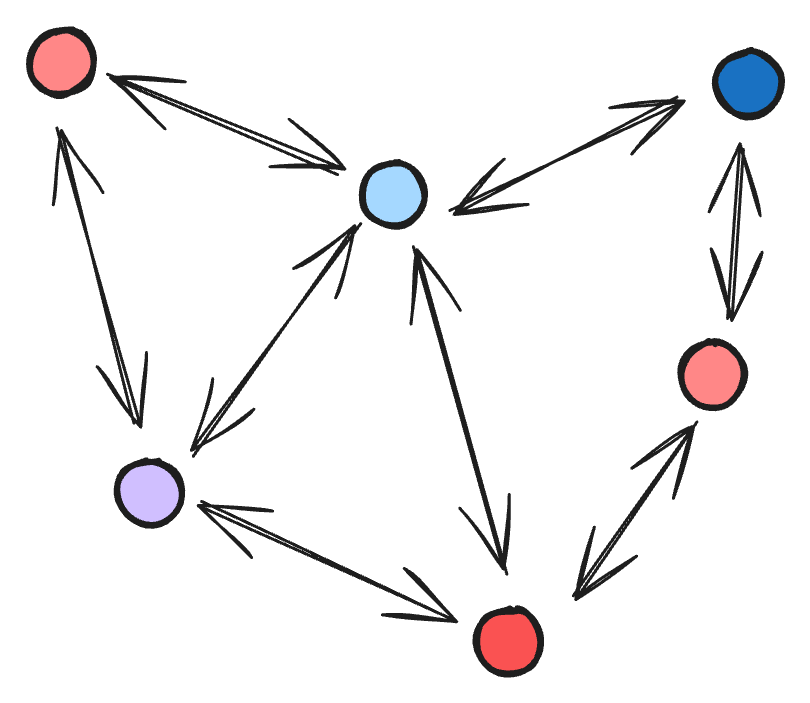
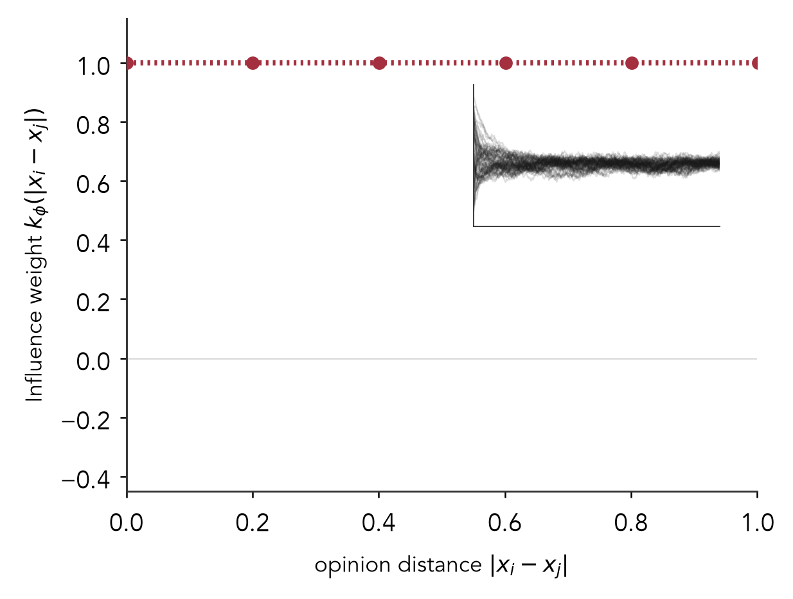
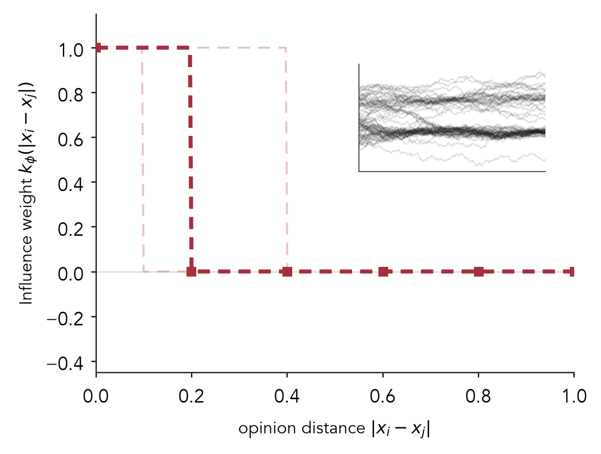
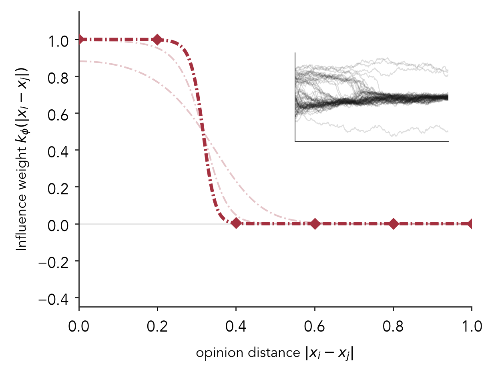
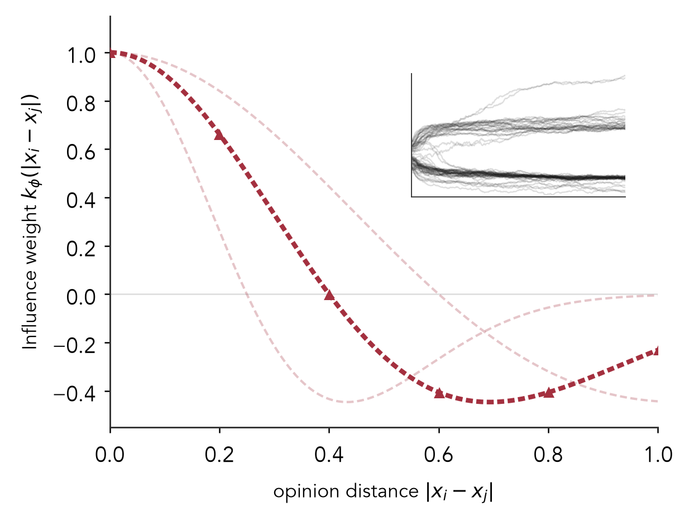
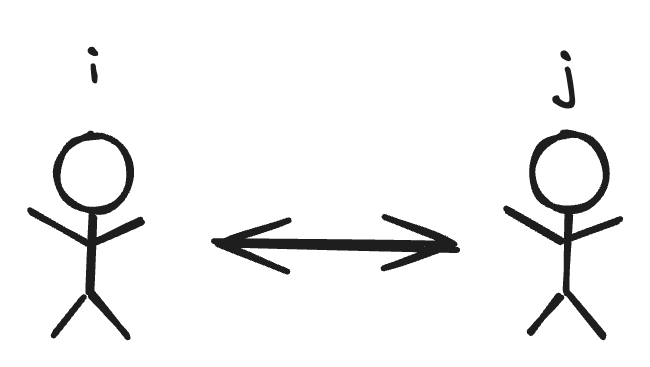
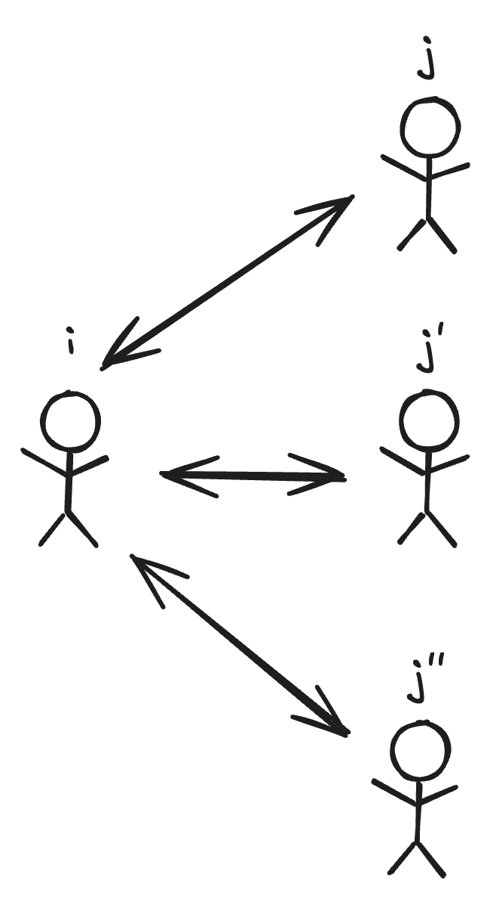

## {.split-40 background-image="../_img/midd/midd-banner-light.jpg" background-size="cover" background-position="center" background-repeat="no-repeat"} 


#### Hi everyone! I'm Phil Chodrow


::: {.column}

<br> <br> 

::: {.textblock}

Prof. of CS at Middlebury College, a small liberal arts college in Vermont.  

:::

::: {.textblock-inverse}

*Students/postdocs: ask me about [**\#LiberalArtsLife**]{.alert} if you're curious.*

:::

::: {.textblock}

I like  aikido, tea, my cats, being outside, hypergraphs, and [math models of social systems]{.alert}. 

:::


:::

::: {.column}

{.absolute left=50 top=120 width=45%}
{.absolute left=50 top=400 width=45%}
{.absolute right=80 top=120 width=25.5%}
{.absolute right=80 top=250 width=25.5%}
{.absolute right=80 top=380 width=25.5%}
{.absolute right=80 top=510 width=25.5%}

::: 

## {.split-50}


::: {.column}

##### [Hey y'all, on a scale from 0-5, how good is this talk?]{.fragment}

{.fragment}

TODO: add white rectangles over top here to reveal the components of this figure one by one

:::

::: {.column}

{.absolute top=0 left=0 width="100%" height="100%" .fragment}

:::

## {background-color="black"}

<br> <br> <br> <br> <br> <br> <br> <br> <br> 

::: {.r-stack}

::: {data-id="box1" style="background: #ffffff; width: 10px; height: 10px; border-radius: 200px;"}

:::


<!--  -->

:::

<br><br><br>

[***Autokinetic effect***: a still point of light in a dark room will appear to move if you stare at it long enough.]{.fragment}

## TODO: highlight line at 0


## 

#### Abstracting Social Influence

Let $x_i(t) \in \mathbb{R}$ be the opinion of agent $i$ at time $t$. 

{height=2.5in  fig-align="center"}

$$
\begin{aligned}
    \underbrace{\color{#d0bfff}{x_1}(t+1) - \color{#a5d8ff}{x_1}(t)}_{\text{opinion change } \delta_i(t+1)} = \overbrace{\lambda}^{\text{Learning rate}} \underbrace{\frac{\color{#fa5252}{x_2}(t) + \color{#ffc9c9}{x_3}(t)}{2}}_{\text{average opinion of neighbors}}
\end{aligned}
$$


## {.split-40}


#### More generally, 

::: {.column}

<br><br><br>

{width="100%"}

[DeGroot (1974). "Reaching a consensus." *JASA*]{.footnote}

:::


::: {.column}

<br><br><br><br><br>

Let $\partial i$ be the set of neighbors of agent $i$. 

$$
\begin{aligned}
    \underbrace{x_i(t+1) - x_i(t)}_{\text{opinion change } \delta_i(t+1)} &= \lambda \underbrace{\frac{1}{|\partial i|}\sum_{j \in \partial i} x_j(t)}_{\text{average opinion of neighbors}} \\ 
\end{aligned}
$$

:::


## {.split-50}

#### A realistic model?

::: {.column}

<br><br>


:::

::: {.column}

<br><br><br>

```{r}
#| echo: false
#| fig.width: 6
#| fig.height: 4

library(tidyverse)

x = c(0.5, 2, 8)
A = matrix(c(0, 1, 1,
             1, 0, 1,
             1, 1, 0), nrow=3, byrow=TRUE)
lambda = 0.5

df = tibble(t = 0, agent = 1:3, opinion = x)
for(t in 1:3){
  x = x + 0.5 * (A %*% x / rowSums(A) - x)
  df = bind_rows(df, tibble(t=t, agent=1:3, opinion=x))
}

df |> ggplot() +
  geom_line(data=df, aes(x=t, y=opinion, linetype=factor(agent)), size=1.5) +
#   scale_color_manual(values=c("#d0bfff", "#fa5252", "#ffc9c9")) +
  theme_minimal() +
  theme(legend.position="none") +
  labs(x="Model timestep", y="Opinion") + 
  scale_y_continuous(limits=c(0, 10)) +
  scale_linetype_manual(values=c("dotted", "dashed", "solid")) + 
  ggtitle("DeGroot (1974) model")
```

:::

<br> <br> <br> <br> <br> <br> <br> <br> <br> <br> <br> <br>

On a connected social graph where all agents listen (at least a little bit) to all their neighbors, DeGroot dynamics always converge to a consensus. 

## {background-image="../_img/kernel-inference/polarized-report.png" background-size="contain" background-position="center" background-repeat="no-repeat"}


## 

#### Generalizing with Influence Kernels

::: {.column}

$$
\begin{aligned}
    \delta_i(t+1) &= x_i(t+1) - x_i(t) \\
    &= \lambda \frac{1}{|\partial i|}\sum_{j \in \partial i} x_j(t)   \quad \quad (\text{DeGroot})
\end{aligned}
$$

{fig-align="center" height=30}

$$
\begin{aligned}
    \delta_i(t+1) &= x_i(t+1) - x_i(t) \\
    &=  \lambda \frac{1}{|\partial i|} \sum_{j \in \partial i} \color{#A4303F}{K(\underbrace{ |x_j(t) - x_i(t)| }_{\text{unsigned distance } d_{ij}})} x_j(t)
\end{aligned}
$$


:::

::: {.column}

<br> <br> <br> 

- *Attraction*: $K(d_{ij}) > 0$
- *Repulsion*: $K(d_{ij}) < 0$
- *Indifference*: $K(d_{ij}) = 0$

We recover DeGroot dynamics if $K(y) \equiv 1$.

[There are other possible ways to normalize this]{.footnote}

:::

## {.split-60}

#### Kernel Zoo: DeGroot Dynamics

::: {.column}

<br>

$$
\begin{aligned}
    \color{#A4303F}{k(d)} &= 1
\end{aligned}
$$

{.absolute top=210 left=0 width="100%"}

:::

::: {.column}

<br>

$$
\begin{aligned}
  \delta_i 
    =  \lambda \frac{1}{|\partial i|} \sum_{j \in \partial i} \color{#A4303F}{k_\phi(d_{ij})} x_j 
\end{aligned}
$$


*Simulated on a random graph with a small amount of random noise incorporated into the update for interest.* 

:::


## {.split-60}

#### Kernel Zoo: Bounded Confidence

::: {.column}

<br> 

$$
\begin{aligned}
    \color{#A4303F}{k_\phi(d)} &= \mathbb{1}[d < \phi]
\end{aligned}
$$

{.absolute top=210 left=0 width="100%"}

:::

::: {.column}

<br> 

$$
\begin{aligned}
  \delta_i 
    =  \lambda \frac{1}{|\partial i|} \sum_{j \in \partial i} \color{#A4303F}{k_\phi(d_{ij})} x_j 
\end{aligned}
$$


Creates sustained opinion clusters at approximately distance $\phi$.


  
[Hegselmann & Krause (2002). "Opinion dynamics and bounded confidence models, analysis, and simulation." *JASSS*.
<br><br>
Deffuant et al. (2000). "Mixing beliefs among interacting agents." *Advances in Complex Systems*.]{.footnote}


:::


## {.split-60}

#### Kernel Zoo: ✨Sigmoidal✨ Bounded Confidence

::: {.column}

<br> 

$$
\begin{aligned}
    \color{#A4303F}{k_\phi(d)} &= \left(1 + \exp \left[\phi_1(d^2 - \phi_0^2)\right]\right)^{-1}
\end{aligned}
$$

{.absolute top=210 left=0 width="100%"}

:::

::: {.column}

<br> 

$$
\begin{aligned}
  \delta_i 
    =  \lambda \frac{1}{|\partial i|} \sum_{j \in \partial i} \color{#A4303F}{k_\phi(d_{ij})} x_j 
\end{aligned}
$$


Converges to bounded-confidence dynamics with radius $\phi_0$ as $\phi_1 \rightarrow \infty$ and to DeGroot dynamics as $\phi_1 \rightarrow 0$.

Allows linear stability analysis of bounded-confidence type behavior. 

[Brooks, **PSC**, Porter (2024). "Emergence of polarization in a sigmoidal bounded-confidence model of opinion dynamics." *SIADS*.]{.footnote}

:::


## {.split-60}

#### Kernel Zoo: Smooth Attraction-Repulsion

::: {.column}

<br>

$$
\begin{aligned}
  \color{#A4303F}{k_\phi(d)} = \left(1 - \frac{d^2}{\phi^2}\right) \exp\left(\frac{d^2}{-2\phi}\right)
\end{aligned}
$$

{.absolute top=210 left=0 width="100%"}

:::

::: {.column}

<br> 

$$
\begin{aligned}
  \delta_i 
    =  \lambda \frac{1}{|\partial i|} \sum_{j \in \partial i} \color{#A4303F}{k_\phi(d_{ij})} x_j 
\end{aligned}
$$


No standard attraction-repulsion kernel; we use a Ricker wavelet. 

Generates close-knit communities that slowly diverge.

[Ryan (1994). "Ricker, Ormsby, Klauder, Butterworth - A Choice of Wavelets." *CSEG Recorder*.]{.footnote}

:::

## {.split-30}


#### How do we learn the kernel from data?

::: {.column}

<br> <br> 

Easiest case: for each $i$ there is only one neighbor $j$. 



$$
\begin{aligned}
  \delta_i
    \approx  \lambda \color{#228be6}{k_\phi}(|\color{#fd7e14}{x_j} - \color{#fd7e14}{x_i}|) \color{#fd7e14}{x_j}
\end{aligned}
$$

:::

::: {.column}

<br> <br> 

{fig-align="center"}

[Adams, White, and Araujo (2022). "Person-to-person opinion dynamics: An empirical study using an online game." *PLoS ONE*.]{.footnote}

:::


## 

{.absolute top=50 right=150 width="30%"}


## {background-image="../_img/kernel-inference/is-this-a.jpeg" background-size="contain" background-position="center" background-repeat="no-repeat" background-color="black"}

{.absolute top=50 right=150 width="30%"}

{.absolute top=50 right=150 width="30%" .fragment}

## {.split-30}

#### A more complex case: multiple neighbors

::: {.column}

<br> 


$$
\begin{aligned}
  \delta_i
    &\approx  \lambda \frac{1}{|\partial i|} \sum_{j \in \partial i} \color{#228be6}{k_\phi}(|\color{#fd7e14}{x_j} - \color{#fd7e14}{x_i}|) \color{#fd7e14}{x_j}
\end{aligned}
$$

:::

::: {.column}

<br> <br> 


[Vande Kerckhove + al. (2016). "Modelling Influence and Opinion Evolution in Online Collective Behaviour." *PLoS ONE*.]{.footnote}

:::


## {.split-40}

#### Some implicit assumptions

::: {.column}

<br> <br> <br> 


[
  At each timestep <br> 
  each agent [***always***]{.alert}  interacts <br> 
  with [***all***]{.alert-2} of their neighbors.
]{style="font-size: 2em;"} 


:::

::: {.column}

<br> <br>


$$
\begin{aligned}
  \delta_i
    &=  \lambda \frac{1}{|\partial i|} \sum_{j \in \partial i} k_\phi(d_{ij}) x_j
\end{aligned}
$$

{width="70%" fig-align="center"}

::: 

## {.split-50}

### Core idea for today: selective attention

::: {.column} 

<br> <br> 

[
  At each timestep <br> 
  each agent [***~~always~~ sometimes***]{.alert} interacts <br> 
  with [***~~all~~ some***]{.alert-2} of their neighbors.
]{style="font-size: 2em;"} 

:::

::: {.column}

<br> <br> 

{width="60%" fig-align="center"}

:::


## 

#### The Team


<table style="padding:0px;border-bottom:0pxmargin: 0px auto; ">
<tr style="border:0px;padding:0px;margin:0px;">
<td style="padding:0px;border-bottom:0px"> 
{.portrait-smallish} 
</td>
<td style="vertical-align: middle;white-space:nowrap;padding:0px;border-bottom:0px">
<p style="padding:0px">**Will Thompson** <br> UVM</p>
</td>

<td style="vertical-align: middle;padding:0px;border-bottom:0px"> 
{.portrait-smallish} 
</td>
<td style="vertical-align: middle;white-space:nowrap;padding:0px;border-bottom:0px">
<p style="padding:0px">**Moyi Tian** <br> CU Boulder</p>
</td>


<td style="vertical-align: middle;padding:0px;border-bottom:0px"> 
{.portrait-smallish} 
</td>
<td style="vertical-align: middle;white-space:nowrap;padding:0px;border-bottom:0px">
<p style="padding:0px">**Linh Huynh** <br> Texas Tech</p>
</td>

<tr>

<td style="vertical-align: middle;padding:0px;border-bottom:0px"> 
{.portrait-smallish} 
</td>
<td style="vertical-align: middle;white-space:nowrap;padding:0px;border-bottom:0px">
<p style="padding:0px">**Alex Wiedemann** <br> Hamline University</p>
</td>


<td style="vertical-align: middle;padding:0px;border-bottom:0px"> 
{.portrait-smallish} 
</td>
<td style="vertical-align: middle;white-space:nowrap;padding:0px;border-bottom:0px">
<p style="padding:0px">**Vicki Modisette** <br> Eastern Kentucky</p>
</td>

<td style="vertical-align: middle;padding:0px;border-bottom:0px"> 
{.portrait-smallish} 
</td>
<td style="vertical-align: middle;white-space:nowrap;padding:0px;border-bottom:0px">
<p style="padding:0px">**Phil Chodrow** <br> Middlebury College</p>
</td>


</tr>

<tr>

<td>
</td>
<td>
</td>

<td style="vertical-align: middle;padding:0px;border-bottom:0px"> 
{.portrait-smallish} 
</td>
<td style="vertical-align: middle;white-space:nowrap;padding:0px;border-bottom:0px">
<p style="padding:0px">**Heather Brooks** <br> Harvey Mudd</p>
</td>

</tr>

</table>

[Work initiated at the AMS Math Research Community on *Mathematics of Social Systems* (2023).]{.footnote}


### 

## 

{width="100%"}

## 

### Our Model

